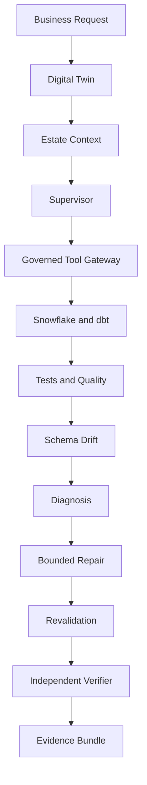
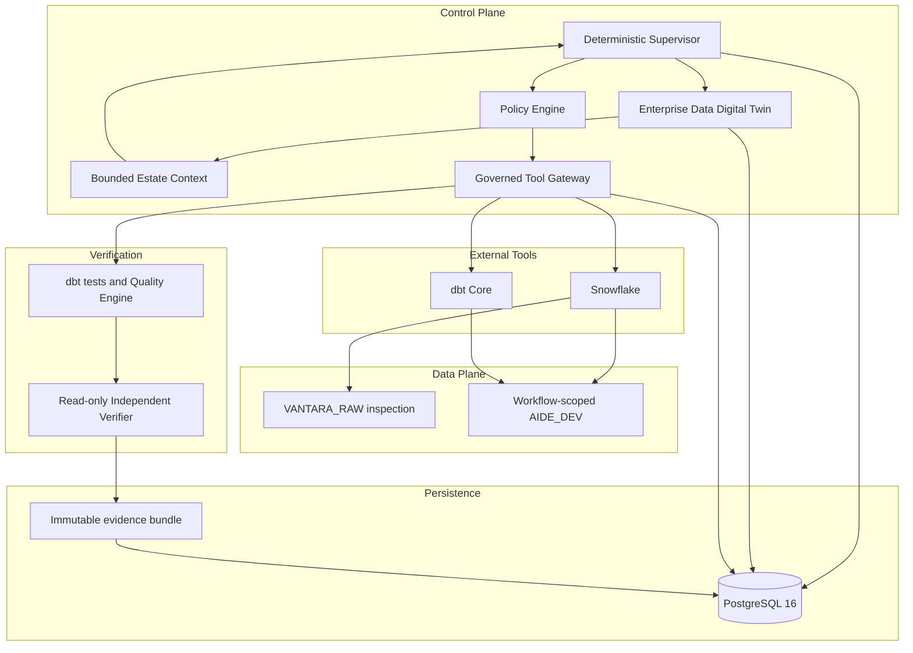
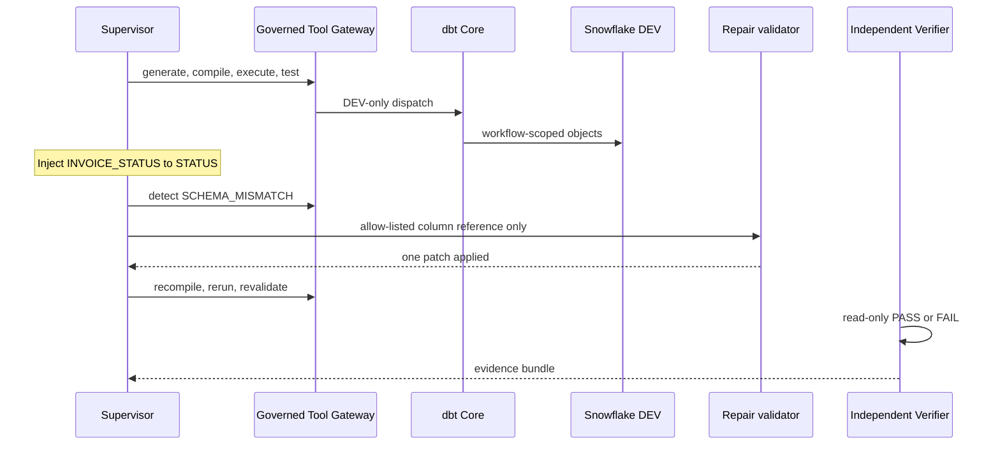

# Data Pilot AI

**Autonomous Data Engineering Control Plane**

Companies keep Snowflake, dbt, and their existing tools. Data Pilot AI understands the
estate, coordinates engineering work, detects failures, performs bounded repairs, and
proves the result with immutable evidence.

The Interview MVP on `main` is a complete governed closed loop: one customer-revenue
request, one pinned Digital Twin, one schema-drift incident, one automatic repair, and a
deterministic Independent Verifier. No LLM decides PASS or FAIL.

| Run the demo | Read the architecture | See what is in and out of scope |
|---|---|---|
| [`uv run aide interview demo`](#demo) | [Architecture](#architecture) | [Current limitations](#current-limitations) |

---

## What problem it solves

Modern data platforms are powerful and fragmented. Snowflake stores data. dbt transforms
it. Orchestrators schedule jobs. Humans still do the expensive work in between: finding
the right tables, modelling a product, generating tests, diagnosing a renamed column, and
proving the repair.

Typical failure modes:

| Problem | What happens without a control plane |
|---|---|
| Fragmented data stacks | Context lives in Slack, tickets, and tribal knowledge |
| Manual engineering work | Staging models, tests, and marts are written by hand |
| Incident diagnosis | A renamed source column becomes a multi-hour debug |
| Unsafe autonomous AI | An agent with warehouse credentials can overreach |
| No deterministic verification | “It looks right” replaces tests, reconciliation, and evidence |

Data Pilot AI is not a SQL chatbot and not a warehouse replacement. It is a **governed
executor** of typed capabilities: an LLM may propose; deterministic code decides,
validates, and records.

---

## Demo workflow

The Interview MVP converts one business request into a verified development data product.



What that loop actually does:

1. Accept a customer-revenue request against the synthetic Vantara estate.
2. Capture and pin an immutable Digital Twin snapshot.
3. Assemble bounded, grant-filtered estate context.
4. Generate and run the dbt data product in workflow-scoped `AIDE_DEV` objects.
5. Inject `INVOICE_STATUS` → `STATUS` on `BILLING.INVOICES`.
6. Detect `SCHEMA_MISMATCH`, apply one allow-listed column-reference repair, and revalidate.
7. Let a read-only Independent Verifier score immutable evidence. Verdict is `PASS` or `FAIL`.

---

## Architecture

Control plane and data plane stay separate. External tools stay replaceable. Verification
cannot mutate the workflow it scores. PostgreSQL is the only control-plane store.



| Plane | Responsibility | Interview MVP fact |
|---|---|---|
| Control plane | Plan, authorize, dispatch, bound repair | Deterministic Supervisor; no multi-agent framework |
| Data plane | RAW inspection and DEV writes | RO reads RAW; RW writes only workflow-scoped `AIDE_DEV` |
| External tools | Warehouse and transformation | Snowflake and dbt Core only |
| Verification | Tests, quality, verdict | Independent Verifier has no connector or workflow-write access |
| Persistence | Twin, intents, audit, evidence | PostgreSQL 16; append-only evidence manifest |

Every connector call enters the Governed Tool Gateway: validate → policy → persist intent →
execute → reconcile ambiguous side effects → persist evidence.



---

## Interview MVP capabilities

Implemented on `main` (MVP001–MVP004). This is what the repository actually runs.

| Capability | Implemented |
|---|---|
| Enterprise Data Digital Twin in PostgreSQL | Yes — assets, relationships, observations, snapshots, evidence refs |
| Pinned twin snapshot and bounded estate context | Yes — one snapshot per workflow; grant-filtered; no source rows in reasoning context |
| Deterministic Supervisor | Yes — application workflow, not an autonomous agent loop |
| Governed Tool Gateway | Yes — sole path to Snowflake and dbt |
| Deterministic modelling engine | Yes — existing DE007 rule table |
| Bounded dbt generation and DEV execution | Yes — 21 required customer-revenue models |
| dbt tests, quality checks, and reconciliation | Yes |
| Schema-drift detection | Yes — `INVOICE_STATUS` → `STATUS` |
| Bounded automatic repair | Yes — one allow-listed SQL column-reference correction |
| Read-only Independent Verifier | Yes — deterministic `PASS` / `FAIL` |
| Immutable evidence bundle | Yes — required sections, content digests, 100% completeness gate |
| Offline deterministic benchmark | Yes — two equivalent runs; no LLM judge |
| Credential-gated Snowflake live smoke | Yes — governed path; missing secrets exit `2`, not a weakened test |

**Not implemented.** Do not read vendor names in architecture docs as shipping connectors.

| Connector / surface | Status |
|---|---|
| Databricks | Future connector extension |
| Microsoft Fabric | Future connector extension |
| Airflow | Future connector extension |
| BigQuery | Future connector extension |
| GitHub delivery / pull requests | Designed in V1 docs; **not** in Interview MVP |
| Frontend SPA | Designed in V1 docs; **not** in Interview MVP |
| Production or staging deploy | Disabled |
| Generic unbounded autonomous loop | Explicitly out of scope |

---

## Data Engineering tasks automated

The Interview MVP automates one closed engineering loop, not the entire enterprise backlog.

| Task | How it is automated |
|---|---|
| Discovery | Enumerate and describe allow-listed Snowflake assets |
| Profiling | Deterministic profiles and relationship candidates |
| Asset selection | Bounded relevant-asset selection from the catalogue |
| Data modelling | Rule-table architecture class; typed model design |
| dbt generation | Staging, intermediate, SCD2 dims, facts, mart, tests, YAML |
| Pipeline execution | dbt compile / run in workflow-scoped DEV |
| Testing | Generated and executed dbt tests |
| Quality | Presence, grain, and mart quality checks |
| Reconciliation | Invoice-line and payment totals versus the mart |
| Incident diagnosis | `SCHEMA_MISMATCH` from injected source drift |
| Bounded repair | One validated column-reference patch; tests cannot be weakened |
| Verification | Read-only Independent Verifier over immutable evidence |
| Evidence | Canonical bundle with section digests |

GitHub PR preparation, duplicate-payment repair, docs/lineage publication, and staging
deploy remain deferred. They are not counted as automated in the benchmark.

---

## What makes this different

| Property | Why it matters |
|---|---|
| Enterprise Data Digital Twin | Estate understanding is a pinned snapshot, not a chatty catalogue dump |
| Vendor-neutral control plane | Orchestrator reasons about capabilities, not “call Snowflake” |
| Deterministic Supervisor | Explicit phases and persisted state; no hidden agent graph |
| Governed Tool Gateway | Policy, intent, execution, reconcile, and evidence on every tool call |
| Least privilege | Distinct RO and DEV identities; no broad RAW grant to DEV |
| Bounded automatic repair | One allow-listed repair class; broader diffs block |
| Independent Verifier | Cannot dispatch tools or write workflow state |
| Immutable evidence | Application-audit bundle with required sections and digests |
| Deterministic benchmark | Two offline runs compared after explicit identifier normalization |
| No LLM judge | PASS / FAIL is code over evidence |

---

## Benchmark results

Source: MVP004 offline Interview scenario
(`interview_mvp_customer_revenue_schema_drift`), recorded in
[`docs/agent/runs/MVP004/MVP004-SESSION-20260915T103100Z-bc01a0a49e.md`](docs/agent/runs/MVP004/MVP004-SESSION-20260915T103100Z-bc01a0a49e.md)
and asserted by `tests/integration/interview/test_benchmark.py`.

**Measured** (not estimates):

| Metric | Value |
|---|---:|
| Relevant assets analyzed | 10 |
| Generated models | 21 |
| Governed tool / policy operations | 36 |
| Tests executed | 23 |
| Quality checks | 25 |
| Detected incidents | 1 (`SCHEMA_MISMATCH`) |
| Automatic repairs | 1 |
| Human interventions | 0 |
| Evidence completeness | 100% |
| Deterministic benchmark | PASS |

**Estimated, labelled, not a productivity study:** nine automated engineering steps from the
versioned baseline in [`docs/EVALUATION_STRATEGY.md`](docs/EVALUATION_STRATEGY.md) §4
(690 minutes). Duplicate-payment repair, documentation/lineage, and GitHub PR are **not**
counted as automated.

**Unavailable on the offline path, never invented:** LLM token cost, Snowflake credits,
financial ROI.

Wall-clock duration is measured per host and is not a product SLA.

---

## Demo

PostgreSQL 16 must be reachable at `AIDE_DATABASE_URL` or `AIDE_TEST_DATABASE_URL`
(default `postgresql+psycopg://ubuntu@127.0.0.1:5432/aide_dev`).

```bash
uv sync --frozen --all-groups
uv run alembic upgrade head
uv run aide interview demo
uv run aide interview benchmark
```

| Command | What you see |
|---|---|
| `uv run aide interview demo` | Human report of the 15-step closed loop, Independent Verifier verdict, evidence digest, determinism, final PASS or FAIL. Runs the scenario **twice**. Exit `0` only on PASS. |
| `uv run aide interview benchmark` | The same run plus the scorecard: drift, repair safety, tests, quality, reconciliation, verifier, evidence completeness, repeatability. |
| `uv run aide interview demo --json` | Machine-readable payload of the same result. |

Offline demo uses fake Snowflake and fake dbt. No vendor credentials are required.

Optional credentialed smoke (env **names** only; never paste values into chat):

```bash
uv run aide interview live-smoke
```

Requires `SNOWFLAKE_ACCOUNT`, `SNOWFLAKE_USER_RO`, `SNOWFLAKE_PRIVATE_KEY_RO`,
`SNOWFLAKE_USER_DEV`, `SNOWFLAKE_PRIVATE_KEY_DEV`, and `SNOWFLAKE_WAREHOUSE_DEV`.
Missing credentials exit `2` (`CREDENTIAL_GATED`). The test is not weakened. Live smoke
does not mutate `VANTARA_RAW` to recreate drift; the drift → repair → verifier loop is the
offline proof.

Full interview script: [`docs/INTERVIEW_DEMO.md`](docs/INTERVIEW_DEMO.md).

---

## Safety and governance

| Control | Interview MVP behaviour |
|---|---|
| DEV only | Production and staging actions are disabled |
| RAW read boundary | `AIDE_DEV_RO` inspects `VANTARA_RAW`; `AIDE_DEV_RW` does not |
| No broad RAW DEV grant | Manifest-mediated dual load into workflow-scoped DEV sources |
| Policy before execution | Every gateway call persists a deterministic risk decision |
| Persisted intent | Dispatch intent, attempt, and fence are recorded before execute |
| Reconcile before retry | Ambiguous side effects are never blindly repeated |
| One automatic repair | Second class, broader AST diff, or failed revalidation blocks |
| Read-only Independent Verifier | No gateway, connector, or workflow-write dependency |
| Evidence integrity | Missing or digest-mismatched required sections fail the verdict |

Evidence is transactional application-audit immutability, not cryptographic tamper
evidence. That limitation is intentional and documented.

---

## Technology

| Layer | Choice |
|---|---|
| Language | Python 3.12 |
| Packaging | uv, committed `uv.lock` |
| Control-plane store | PostgreSQL 16, SQLAlchemy 2, Alembic |
| API | FastAPI (thin health, session, and workflow submit; no product UI) |
| CLI | Typer (`aide interview …`) |
| Warehouse | Snowflake (real + deterministic fake) |
| Transformation | dbt Core 1.11 with `dbt-duckdb` offline and `dbt-snowflake` live |
| SQL safety | sqlglot parse / render / reparse |
| Quality | Deterministic Quality Engine; no LLM judge |
| Orchestration | Custom state machine; not LangGraph, LangChain, CrewAI, or AutoGen |

---

## Repository map

Start at this README, then the interview demo, then architecture.

```text
AIDataEngineer/
├── README.md                 ← you are here
├── docs/
│   ├── INTERVIEW_DEMO.md     ← how to run and narrate the demo
│   ├── ARCHITECTURE.md       ← control-plane architecture
│   ├── MVP_SCOPE.md          ← implemented Interview MVP boundary
│   ├── pivot/                ← PIVOT001 contract
│   └── agent/runs/           ← execution evidence (not the landing page)
├── src/aide/
│   ├── app/                  ← Supervisor, gateway, interview, benchmark
│   ├── twin/                 ← Digital Twin
│   ├── verification/         ← Independent Verifier and evidence bundle
│   ├── repair/               ← bounded repair
│   ├── connectors/           ← snowflake/ and dbt/ (real + fake)
│   ├── policy/               ← deterministic policy and SQL classifier
│   ├── modelling/            ← modelling engine
│   ├── generation/           ← bounded dbt generation
│   ├── quality/              ← quality and reconciliation
│   └── cli/                  ← aide interview demo | benchmark | live-smoke
├── synthetic/vantara/        ← deterministic Vantara fixtures
├── dbt/                      ← dbt project skeleton
└── tests/                    ← unit, integration, connector, security, contracts
```

Reviewer path:

1. This README (product in ~60 seconds).
2. [`docs/INTERVIEW_DEMO.md`](docs/INTERVIEW_DEMO.md) (run and talk track).
3. [`docs/ARCHITECTURE.md`](docs/ARCHITECTURE.md) and
   [`docs/pivot/PIVOT001_CONTRACT_BOUNDARY.md`](docs/pivot/PIVOT001_CONTRACT_BOUNDARY.md).
4. `src/aide/app/supervisor.py`, `src/aide/app/gateway.py`, `src/aide/verification/`.

Agent run reports under [`docs/agent/runs/`](docs/agent/runs/) are session evidence. They
are not the product introduction.

---

## Documentation index

| Document | Why open it |
|---|---|
| [Interview demo](docs/INTERVIEW_DEMO.md) | Commands, expected PASS criteria, live-smoke posture |
| [Interview MVP scope](docs/MVP_SCOPE.md) | Implemented boundary and hard limits |
| [Architecture](docs/ARCHITECTURE.md) | Components, trust boundaries, extensibility |
| [PIVOT001 contract](docs/pivot/PIVOT001_CONTRACT_BOUNDARY.md) | Twin, gateway, repair, verifier, acceptance tests |
| [Execution flow](docs/EXECUTION_FLOW.md) | V1 worked example (broader than the Interview MVP) |
| [Capability model](docs/CAPABILITY_MODEL.md) | Typed capabilities the orchestrator may invoke |
| [Connector architecture](docs/CONNECTOR_ARCHITECTURE.md) | Protocol, Snowflake/dbt, future kinds |
| [Data engineering map](docs/DATA_ENGINEERING_CAPABILITY_MAP.md) | Lifecycle taxonomy versus automation |
| [Permission model](docs/PERMISSION_MODEL.md) | Grants, policy, identities, repair bounds |
| [Quality strategy](docs/QUALITY_STRATEGY.md) | Deterministic checks; no LLM correctness judge |
| [Evaluation strategy](docs/EVALUATION_STRATEGY.md) | Benchmark philosophy and labelled time baseline |
| [Tech stack](docs/TECH_STACK.md) | Language, store, dbt, tooling decisions |
| [ADRs](docs/adr/README.md) | Architecture decision records |

---

## Current limitations

The Interview MVP is intentionally narrow.

- One business scenario: Vantara customer revenue.
- One automatic repair class: allow-listed `INVOICE_STATUS` → `STATUS` column reference.
- Snowflake and dbt only; other vendors are future extensions.
- Production and staging are disabled.
- No large UI; interface is CLI plus evidence report.
- No generic autonomous loop, dynamic tool selection, or unbounded estate traversal.
- GitHub delivery, monitoring, and a required live LLM provider are out of scope.
- Live Snowflake smoke is credential-gated and does not inject RAW drift.
- Evidence is application-audit immutability, not cryptographic tamper evidence.

---

## Roadmap

Logical connector expansion after the Interview MVP. **None of these are implemented.**

```text
Implemented today
  PostgreSQL control plane
  Snowflake
  dbt Core

Future connector extensions
  Databricks
  Microsoft Fabric
  Airflow
  BigQuery
  cloud platforms (object storage, additional warehouses)
  BI tooling (semantic / dashboard metadata)
```

Adding a warehouse or transformation platform is a connector plus tests. It is not a
rewrite of Supervisor, policy, or the verifier.

---

## Why this matters

Most “AI data engineer” demos generate SQL. This repository shows a **control plane**:
pinned estate context, least-privilege identities, a policy gateway, one bounded repair,
and an independent verifier that cannot mark its own homework. That is the difference
between an assistant that talks about data engineering and a system that can be trusted
to perform a slice of it.
