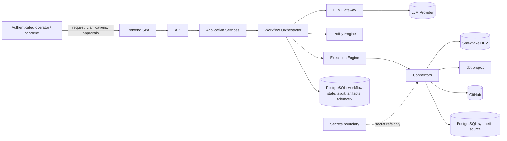

# AI Data Engineer — Architecture V1

**Task:** DE 001 (corrected by DE 001R1 and DE 001R2A) · **Status:** PROPOSED (awaiting independent review acceptance) · **Date:** 2026-09-11
**Owner of changes after acceptance:** ADR + higher-tier review (see `.ai/MASTER_WORKFLOW.md` §20)

This is the buildable architecture for the AI Data Engineer control plane. It is the
authoritative product architecture. Companion documents refine individual areas and are
listed in §12. Where a companion document conflicts with this file, this file wins and the
companion is corrected.

---

## 1. What the system is

An **AI Data Engineering control plane**: a human describes a data engineering outcome in
natural language; the system plans, discovers metadata, profiles data, decides a modelling
strategy, generates transformations (SQL / dbt / Python), executes them in a development
environment, validates deterministically, diagnoses and repairs bounded failures, produces
documentation and lineage, prepares Git changes and a pull request, and stops at explicit
human approval gates before anything reaches staging or production.

It is **not** a chatbot, a code generator, or an autonomous administrator. It is a
governed executor of typed capabilities, in which an LLM proposes and deterministic code
decides, validates, and enforces.

### 1.1 Architectural thesis

| Principle | Consequence in V1 |
|---|---|
| Separate AI reasoning from deterministic execution | LLMs only run inside **reasoning capabilities** with typed inputs and outputs. Everything that touches an external system is a **deterministic capability** executed through a connector behind the policy engine. |
| Critical policy never lives only in prompts | Permissions, SQL safety, approval gates, retry limits, cost limits, state transitions, and validation are Python code with tests. Prompts may *remind*; code *enforces*. |
| Capability-first, vendor-second | The orchestrator reasons about `execute_query`, never about "Snowflake". Connectors advertise which capabilities they implement. |
| Explicit, persisted state | Every workflow, task, artifact, approval, model call and tool call is a row. No agent conversation is an integration mechanism. |
| Modular monolith | One Python package, one process (API + worker in-process for V1, separable later), one PostgreSQL database. No microservices, Kubernetes, Kafka, Redis or vector database in V1 (see §10). |
| Controlled autonomy | Automation is permitted where the result can be validated objectively and reversed safely. Everything else is a human gate. |
| Testable without production credentials | Every connector has a deterministic fake. Every LLM call has a replayable fake. The full demo runs offline. |

---

## 2. System context



Trust boundaries (details in `docs/PERMISSION_MODEL.md` §8):

- **Human ↔ System**: local opaque server-side session creates trusted `PrincipalRef`;
  roles and effective workflow grants are derived server-side. Clients may request grants
  but cannot set actor, roles or grants. Typed approvals bind to their complete subject.
- **System ↔ LLM provider**: outbound only; secrets, raw credentials and full source rows never enter prompts; all outputs are untrusted until parsed and validated.
- **System ↔ data platforms**: least-privilege per-environment identities; connector and
  LLM provider adapters resolve only scoped allow-listed secret references.
- **Metadata and source data → System**: untrusted input. Table names, comments, column values can carry prompt injection; they are treated as data, quoted and delimited in prompts, and never executed.

---

## 3. Logical components

All components below are Python modules in one package (`src/aide/`). None is a separate
process in V1. The worker loop that executes tasks runs in-process with the API by default
and can be started as a second process of the same image when isolation is wanted
(`aide worker`). Component boundaries are enforced by module layout, import rules (see
`docs/IMPLEMENTATION_PLAN.md` §2) and typed interfaces, not by network hops.

Legend — **Det**: deterministic code. **LLM**: LLM reasoning, always via the LLM Gateway,
output always validated by Det code before use.

### 3.1 Frontend

| | |
|---|---|
| Responsibility | Submit requests; answer clarification questions; show plan, task timeline, artifacts, validation results, diagnoses, repairs, cost; resolve approvals; show connector status. |
| Inputs | API responses (JSON), server-sent events for progress. |
| Outputs | User intents (request, clarification answer, approval decision, cancel). |
| Dependencies | API only. |
| State ownership | None (view state only). |
| Security boundary | Browser; authenticated session; no secrets; renders untrusted strings escaped. |
| Det / LLM | Det. |

### 3.2 API

| | |
|---|---|
| Responsibility | Thin, typed HTTP surface. Local account login and opaque PostgreSQL-backed session, CSRF enforcement, trusted `PrincipalRef` propagation, request validation, DTO mapping, same-origin read-only SSE. No business logic. |
| Inputs | HTTP requests with Pydantic DTOs. |
| Outputs | Typed responses; errors mapped from domain exceptions to safe messages. |
| Dependencies | Application Services. |
| State ownership | None. |
| Security boundary | Public boundary of the system. Rate limiting, auth, input size limits. |
| Det / LLM | Det. |

### 3.3 Application Services

| | |
|---|---|
| Responsibility | Use cases: `submit_request` (server-authorized grants), `answer_clarification`, `resolve_approval`, `resume_workflow`, `verify_or_import_ambiguous_result`, `confirm_effect_result_unknown`, `cancel_workflow`, `park_unresolved_and_cancel`, queries and evaluation. Transaction boundaries. A human assertion alone cannot mark an ambiguous task successful. |
| Inputs | Commands from API/CLI/evaluation harness. |
| Outputs | Domain results; emits domain events. |
| Dependencies | Workflow State Manager, Orchestrator (to enqueue), Approval Engine, Artifact Manager, repositories. |
| State ownership | None (coordinates owners). |
| Security boundary | Authorization checks on who may approve what. |
| Det / LLM | Det. |

### 3.4 Workflow Orchestrator

| | |
|---|---|
| Responsibility | Drives the state machine through explicit `phase_runs`. Accepts one immutable task-template DAG per occurrence, invokes the exhaustive phase reducer, and advances under a transaction-scoped PostgreSQL advisory lock keyed by workflow. Phase completion, next-plan acceptance, template creation and transition serialize exactly once. |
| Inputs | Workflow record, phase results, policy decisions, approval outcomes. |
| Outputs | State transitions, task graphs, workflow events. |
| Dependencies | Planner, Workflow State Manager, Task Scheduler, Policy Engine, Approval Engine, Repair Engine. |
| State ownership | Workflow state (through the State Manager). |
| Security boundary | Internal. Cannot call connectors directly; only through tasks. |
| Det / LLM | Det. It never "thinks"; it executes transition rules. |

### 3.5 Planner

| | |
|---|---|
| Responsibility | Reasoning capability `plan_workflow` / `plan_phase`: turn requirement + discovered context into a typed `Plan` (goal, assumptions, clarification questions, phase task graph with capability ids and inputs). |
| Inputs | `RequirementSpec`, `WorkflowContext` summary (metadata, profiles, prior results), Capability Registry catalogue (ids + purposes + permissions). |
| Outputs | `Plan` (Pydantic). Structural validation uses the phase contract snapshot, connector kind/version compatibility, effective server-authorized grants, template schemas and DAG bounds. Temporary connector health never invalidates a plan; it is evaluated after operation materialization and can park work. |
| Dependencies | LLM Gateway, Capability Registry (read-only). |
| State ownership | None; the Plan becomes an artifact owned by Artifact Manager. |
| Security boundary | Receives redacted, delimited context only. |
| Det / LLM | LLM proposes; Det validates and can reject/replan (max 2 replans). |

### 3.6 Workflow State Manager

| | |
|---|---|
| Responsibility | Applies transitions only through the state table; stores optimistic version, cancellation intent/epoch and active phase run. Every mutation and audit event share a transaction. Advisory transaction locking serializes phase advancement; optimistic versioning detects stale commands. |
| Inputs | Transition requests `(workflow_id, from, to, reason, actor)`. |
| Outputs | Persisted workflow; `WorkflowTransitioned` event. |
| Dependencies | Persistence. |
| State ownership | **Owns** `workflows`, `workflow_events`. |
| Security boundary | Internal. |
| Det / LLM | Det. |

### 3.7 Task Graph & Scheduler

| | |
|---|---|
| Responsibility | Persist phase runs and immutable task templates; materialize only fully resolved/validated input; compute resolved-input digest and operation key; cascade every required dependency failure; claim with `SKIP LOCKED`, renewable leases and monotonic claim epochs; condition every heartbeat/finalization on owner+epoch+attempt+cancellation epoch; reconcile every ambiguous side-effecting result before retry; reject stale worker results. |
| Inputs | Task graph from Orchestrator; task results from Execution Engine. |
| Outputs | Task lifecycle events; phase completion signal. |
| Dependencies | Persistence, Execution Engine. |
| State ownership | **Owns** `phase_runs`, `task_templates`, `tasks`, `task_attempts`, recovery claims and unresolved effects. |
| Security boundary | Internal. |
| Det / LLM | Det. |

### 3.8 Capability Registry

| | |
|---|---|
| Responsibility | Catalogue of versioned typed capability contracts: input/output schema versions, permission, risk, typed approval rule, `max_attempts`, effect semantics, validators, audit and connector requirement. Creates immutable phase contract snapshots. |
| Inputs | Declarative registrations at import time. |
| Outputs | Lookup + catalogue for Planner (names/purposes only) and Policy Engine. |
| Dependencies | None. |
| State ownership | In-memory, immutable after startup; versioned. |
| Det / LLM | Det. |

### 3.9 Tool Registry

| | |
|---|---|
| Responsibility | Resolves a phase-pinned `(capability_id@version, connector_id@version?)`. Only materialized immutable input may enter. Wraps policy, typed approvals, attempt intent/fencing, dispatch classification, mandatory ambiguous-outcome reconciliation, output validation, transactional audit and telemetry. |
| Inputs | Task (capability, connector, inputs). |
| Outputs | Validated `CapabilityResult`. |
| Dependencies | Capability Registry, Connector Registry, Policy Engine, Audit, Observability. |
| State ownership | None. |
| Security boundary | **The only path to external systems.** Nothing else may import a connector. |
| Det / LLM | Det wrapper; may invoke an LLM reasoner as the implementation of a reasoning capability. |

### 3.10 Connector Registry & Connectors

| | |
|---|---|
| Responsibility | Stable connector protocol with advertised supported capability/schema versions, immutable TTL-bound health snapshots, complete recovery context and bounded `IN_PROGRESS` reconciliation. V1: Snowflake, dbt, GitHub, PostgreSQL, each real + fake. |
| Inputs | Configuration with secret references; capability calls. |
| Outputs | Typed capability results; connector status. |
| Dependencies | Secrets boundary, vendor SDKs. |
| State ownership | Immutable connector health snapshots. |
| Security boundary | **Data-platform credential boundary.** Connector adapters receive scoped allow-listed secret resolvers. LLM provider adapters have a separate scoped resolver. |
| Det / LLM | Det. |

### 3.11 Metadata Discovery

| | |
|---|---|
| Responsibility | Deterministic enumeration of databases, schemas, tables, columns, constraints, comments, row counts, freshness via `discover_assets` / `describe_asset`; builds a `MetadataCatalog` artifact; marks all free-text metadata as untrusted. |
| Inputs | Scope (databases/schemas allow-list), connector. |
| Outputs | `MetadataCatalog` (typed). |
| Dependencies | Tool Registry. |
| State ownership | `metadata_snapshots` (immutable, hashed). |
| Det / LLM | Det. Relevance ranking of assets for a requirement is an LLM reasoning capability (`select_relevant_assets`) whose output must be a subset of the catalogue. |

### 3.12 Profiling

| | |
|---|---|
| Responsibility | Generate and run deterministic profiling SQL (counts, null ratios, distinct ratios, min/max, top-k, candidate keys, candidate foreign keys via inclusion dependency sampling, duplicate detection). Sampling is bounded by row and byte budgets. |
| Inputs | Asset ids, budget. |
| Outputs | `DatasetProfile`, `RelationshipCandidates`. |
| Dependencies | Tool Registry (`profile_dataset`, `sample_dataset`, `execute_query`). |
| State ownership | `profiles` (immutable). |
| Det / LLM | Det. Interpretation ("this looks like a soft-delete flag") is LLM, stored as *hypotheses* with confidence and never as facts. |

### 3.13 Data Modelling Engine

| | |
|---|---|
| Responsibility | Decide layered architecture and model patterns using objective signals (`docs/DATA_MODELLING_STRATEGY.md`), produce a typed `ModelDesign` (layers, entities, grain, keys, SCD types, incremental strategy, tests). |
| Inputs | `RequirementSpec`, `MetadataCatalog`, `DatasetProfile`s, `RelationshipCandidates`, platform capabilities. |
| Outputs | `ModelDesign` + human-readable rationale. |
| Dependencies | LLM Gateway (for entity/business mapping), decision rules (Det). |
| State ownership | None (artifact). |
| Det / LLM | **Det chooses architecture class from a rule table**; LLM proposes entity mapping, naming, and column-level transformations inside the chosen class; Det validates grain/key consistency against profiles. |

### 3.14 Transformation Generator

| | |
|---|---|
| Responsibility | Produce dbt models (SQL + YAML), tests, and Python where needed from `ModelDesign`. Uses templates for structure and LLM for column logic. Every generated SQL passes the SQL Safety Classifier and `validate_query` (compile/explain) before it becomes an artifact. |
| Inputs | `ModelDesign`, metadata, dialect, project conventions. |
| Outputs | `GeneratedArtifactSet` (files with hashes). |
| Dependencies | LLM Gateway, SQL Safety Classifier, Tool Registry (`validate_query`), Artifact Manager. |
| State ownership | None (artifacts). |
| Det / LLM | Hybrid: templates and validation Det; expression logic LLM. |

### 3.15 Quality Engine

| | |
|---|---|
| Responsibility | Deterministic validation (`docs/QUALITY_STRATEGY.md`): schema conformance, nulls, uniqueness, referential integrity, accepted values, freshness, reconciliation between source and target, row count deltas, distribution shifts. Parses dbt `run_results.json`. Produces `ValidationReport` with pass/fail per check. |
| Inputs | Artifacts, execution results, expectations from `ModelDesign`. |
| Outputs | `ValidationReport`. |
| Dependencies | Tool Registry (`run_tests`, `execute_query`). |
| State ownership | `validation_reports`. |
| Det / LLM | Det only. |

### 3.16 Execution Engine

| | |
|---|---|
| Responsibility | Execute a task: resolve tool, apply policy, enforce timeout, byte/row/cost limits, statement count limits, environment binding (dev only in V1), capture output, classify errors, persist attempt. |
| Inputs | Claimed task. |
| Outputs | `ExecutionResult` (status, output ref, metrics, error). |
| Dependencies | Tool Registry, Policy Engine, Failure Classifier, Observability. |
| State ownership | `task_attempts` results (via Scheduler). |
| Security boundary | Enforces environment binding: a task carries `target_environment`; a connector instance is bound to exactly one environment. |
| Det / LLM | Det. |

### 3.17 Failure Classifier

| | |
|---|---|
| Responsibility | Map an error (connector exception, SQL error code, dbt result, validation failure) to a `FailureClass` (`docs/PERMISSION_MODEL.md` §10) with `repairable`, `retryable`, `escalate` flags. |
| Inputs | Raw error, capability, connector, context. |
| Outputs | `FailureClassification`. |
| Dependencies | Connector-provided error mappers. |
| State ownership | None. |
| Det / LLM | Det rule tables first. If unclassified → `UNKNOWN`, which is **never** auto-repaired; an LLM may *suggest* a class for the human, labelled as suggestion. |

### 3.18 Repair Engine

| | |
|---|---|
| Responsibility | Bounded self-correction loop: gather evidence, request a `RepairProposal` (diagnosis + changed hypothesis + patch) from the `diagnose_failure` reasoning capability, reject proposals whose hypothesis hash repeats a previous attempt, apply the patch as a new artifact version, re-run policy → execution → validation. Max attempts per task and per workflow; termination and escalation rules. |
| Inputs | `FailureClassification`, evidence bundle (error, SQL, model, metadata excerpt, test results). |
| Outputs | New artifact version + repair event, or escalation. |
| Dependencies | LLM Gateway, Artifact Manager, Orchestrator. |
| State ownership | `repair_attempts`. |
| Det / LLM | LLM proposes; Det bounds, validates, applies, and terminates. |

### 3.19 Policy Engine

| | |
|---|---|
| Responsibility | Evaluate every applicable deterministic denial rule over the materialized operation, trusted principal/grant authorization, fresh connector health, provenance and SQL classification. Persist all reasons; derive route from `SECURITY > SCOPE > ENVIRONMENTAL`; evaluate all approval requirements only when no denial exists. SQL classification covers normalized scope, functions, stages/URLs, dynamic/session constructs and unknown AST nodes. |
| Inputs | `PolicyRequest`. |
| Outputs | `PolicyDecision` (persisted). |
| Dependencies | Capability Registry, permission model config. |
| State ownership | `policy_decisions`. |
| Security boundary | **Every external-effect path passes here.** Not bypassable by any caller because the Tool Registry wrapper invokes it. |
| Det / LLM | Det only. The LLM has no API to grant permissions. |

### 3.20 Approval Engine

| | |
|---|---|
| Responsibility | Manage discriminated `OperationApproval`, `DesignApproval` and `BudgetIncreaseApproval` subjects. Operation subjects bind operation key, resolved-input digest, artifact/provenance closure, capability/connector versions, target, permission, external-state digest and expiry. All simultaneous mandatory subjects must approve; any rejection follows subject-specific routing. |
| Inputs | `REQUIRE_APPROVAL` decisions; human decisions from API. |
| Outputs | `ApprovalRecord`; resumes or blocks the workflow. |
| Dependencies | Persistence, Workflow State Manager. |
| State ownership | `approvals`. |
| Security boundary | Only trusted principals holding `approver`; design acceptance is not a grant and budget approval only changes an explicit cap. |
| Det / LLM | Det. |

### 3.21 Artifact Manager

| | |
|---|---|
| Responsibility | Content-addressed immutable storage with payload schema version and transitive provenance (`REAL|MOCK`, connector/capability versions, operation key and resolved-input digest). Real Git/deploy rejects MOCK ancestry; promotion recreates and validates through real connectors. |
| Inputs | Bytes + type + producer task. |
| Outputs | `ArtifactRef` (id, sha256, version, type). |
| Dependencies | Persistence. |
| State ownership | **Owns** `artifacts`. |
| Det / LLM | Det. |

### 3.22 Delivery (Git) Service

| | |
|---|---|
| Responsibility | Materialize an artifact set into a Git working tree of the dbt project, create branch, commit, push, open PR with generated summary (via GitHub connector). Deploy = merge/promote through platform-specific capability, gated by approval. |
| Inputs | Approved artifact set, repository config. |
| Outputs | Branch, commit sha, PR url as artifacts. |
| Dependencies | Tool Registry (`prepare_git_change`, `prepare_pull_request`, `deploy_staging`; `deploy_production` disabled in V1). |
| State ownership | None. |
| Det / LLM | Det (PR description text is LLM-generated but stored as an artifact and human-reviewed). |

### 3.23 Audit System

| | |
|---|---|
| Responsibility | Transactional append-only application record of consequential actions. State mutation and audit event commit together; per-workflow sequence allocation is locked and unique. Writer role lacks UPDATE/DELETE; V1 does not claim cryptographic tamper evidence. |
| Inputs | Events from every component through one interface. |
| Outputs | Queryable audit timeline per workflow. |
| Dependencies | Persistence. |
| State ownership | **Owns** `audit_events`. |
| Security boundary | Redaction is applied before write; no secrets, no full source rows. |
| Det / LLM | Det. |

### 3.24 Observability

| | |
|---|---|
| Responsibility | Structured logs, traces (OpenTelemetry), metrics, model-call accounting (tokens, latency, cost), tool-call accounting, warehouse metrics (`docs/OBSERVABILITY.md`). |
| Inputs | Spans/events from components. |
| Outputs | Persisted `model_calls`, `tool_calls`, `workflow_metrics`; OTLP export optional. |
| Dependencies | Persistence, OTel SDK. |
| State ownership | Telemetry tables. |
| Det / LLM | Det. |

### 3.25 Evaluation

| | |
|---|---|
| Responsibility | Run benchmark scenarios against fake or real connectors, compute metrics (`docs/EVALUATION_STRATEGY.md`), persist results, produce comparison reports. |
| Inputs | Scenario definitions (YAML), configuration. |
| Outputs | `EvaluationRun` records and report. |
| Dependencies | Application Services (uses the same entry points as the UI). |
| State ownership | `evaluation_runs`, `evaluation_results`. |
| Det / LLM | Det harness; LLM-as-judge is **not** used for pass/fail in V1. |

### 3.26 LLM Gateway

| | |
|---|---|
| Responsibility | Single point for model calls: provider adapters, versioned prompts, structured output, bounded retries, redaction, replay fake and an atomic budget reservation/settlement ledger. Provider adapters resolve only their scoped `SecretRef`s. |
| Inputs | `LLMRequest` (template id + version, variables, output schema, model config). |
| Outputs | Parsed, schema-validated Pydantic object or `LLMOutputInvalid` error. |
| Dependencies | Provider SDK, Observability, Secrets boundary (API key ref). |
| State ownership | `model_calls`. |
| Security boundary | **Redaction boundary.** Enforces context allow-lists: prompts may include metadata, profiles, artifacts, errors; never secrets or unbounded raw rows (sample rows capped and column-masked when classified sensitive). |
| Det / LLM | Det wrapper around LLM. |

### 3.27 Persistence

| | |
|---|---|
| Responsibility | SQLAlchemy 2 models and repositories, Alembic migrations, unit-of-work. No prompts, no LLM logic. |
| Inputs / Outputs | Domain objects ↔ rows. |
| Dependencies | PostgreSQL. |
| State ownership | Physical storage; logical ownership belongs to components above. |
| Det / LLM | Det. |

### 3.28 Secrets Boundary

| | |
|---|---|
| Responsibility | `SecretProvider` protocol: `resolve(SecretRef) -> SecretStr`. V1: environment variables. Future: cloud secret managers. Secret values never persist, never log, never enter LLM context. |
| Inputs | `SecretRef` name plus adapter-scoped allow-list from connector or LLM provider configuration. |
| Outputs | In-memory `SecretStr` with a short lifetime. |
| Dependencies | Environment / secret manager. |
| Security boundary | Yes — see `docs/PERMISSION_MODEL.md` §8. |
| Det / LLM | Det. |

---

## 4. Workflow representation

Two levels (ADR DE-ADR-011):

1. **Workflow state machine**: explicit cancellation intent/shutdown states, parking,
   failure and terminal outcomes (`docs/STATE_MODEL.md`).
2. **Phase run**: each executable phase occurrence has `phase_run_id`, monotonic
   generation, pinned contract snapshot, immutable accepted plan and templates.
3. **Materialized operation**: dependency references resolve and validate before immutable
   input digest, operation identity, policy or approval exists.

Adaptivity occurs only at phase boundaries. Discovery enumeration therefore completes
before a new planning boundary creates an explicit sorted description task per asset;
there is no runtime insertion into an active DAG.

### 4.1 Executable task

```text
Task
  task_id, template_id, workflow_id, phase_run_id, phase
  capability_id@contract_version, input/output_schema_version
  connector_id@version?, target_environment, contract_snapshot_id
  depends_on: [task_id]
  resolved_inputs: immutable validated JSON; resolved_input_digest
  outputs: typed JSON (validated against output schema) | null
  required_permission, risk, typed approval requirements
  timeout_seconds, max_attempts, retry_policy, effect_semantics
  validation: [validator ids]
  artifacts: [ArtifactRef with transitive REAL|MOCK provenance]
  execution_result, failure_classification
  operation_idempotency_key
  attempt_count, status, version, claim_epoch
  lease_owner, lease_expires_at, last_heartbeat_at

TaskAttempt (append-only, one per execution try)
  attempt_id, task_id, attempt_number, operation key/input digest copies
  lease_owner, claim_epoch, cancellation_epoch, dispatch_state
  outcome: STARTED|SUCCEEDED|FAILED|EXPIRED|RECOVERED|AMBIGUOUS|CANCELLED
```

`operation_idempotency_key` includes `phase_run_id`, pinned implementation versions and
resolved-input digest, so it is stable across attempts but distinct across legitimate phase
re-entry. Renewable heartbeats and epoch predicates fence stale workers. Atomic recovery
ownership advances the epoch; late completion cannot overwrite replacement/recovery state.
Every ambiguous side effect reconciles before retry. Phase reduction/advance is one
serialized PostgreSQL transaction with exhaustive required-dependency propagation.

---

## 5. Agent model (summary)

One orchestrator (Det), one planner (LLM capability), a small fixed set of **reasoning
capabilities** with role-specific prompts and typed outputs. No autonomous specialist
agents, no agent-to-agent chat. Reasoning capabilities in V1:

`interpret_requirement`, `plan_phase`, `select_relevant_assets`, `propose_model_design`,
`generate_transformation`, `generate_sql_query` (single-statement development SQL),
`diagnose_failure` (→ `RepairProposal`), `generate_documentation`, `summarize_for_human`.

Rationale, rejected alternatives and the evaluation of each candidate specialist are in
`docs/AGENT_MODEL.md`.

---

## 6. Human / AI responsibility matrix

| Area | Human | AI platform (Det + LLM) |
|---|---|---|
| Business objective and success criteria | Owns | Interprets, restates, asks clarifications |
| Ambiguous business semantics (metric definitions, entity identity rules, SCD policy when unclear) | Decides | Detects ambiguity, proposes options with evidence, blocks on `CLARIFICATION_REQUIRED` |
| Access authorization (which systems, schemas, identities) | Grants | Requests; never self-grants |
| Material architecture decisions (e.g., Data Vault vs star, new platform) | Approves when rule table says `REQUIRE_APPROVAL` or signals conflict | Proposes from rule table with rationale |
| Technical design inside approved class (grain, keys, staging shape) | Reviews via PR | Decides and documents |
| Code generation (SQL, dbt, YAML, Python) | Reviews via PR | Generates, validates, tests |
| Development execution | — | Automatic within sandbox and cost limits |
| Test creation and execution | — | Automatic |
| Failure diagnosis and repair of repairable classes | Informed | Automatic within bounds; escalates on limit |
| Non-repairable failures (permission, ambiguity, unsafe, unknown) | Decides | Stops, explains, proposes |
| Documentation and lineage | Reviews | Generates |
| Git branch, commit, PR | Reviews and merges | Prepares |
| Staging deploy | Approves | Executes after approval |
| Production write / deploy | Owns future enablement | `deploy_production` is disabled and has no connector in V1 |
| Destructive actions (drop, delete, truncate, overwrite history) | Approves each | Never automatic; V1 denies except in sandbox with approval |
| Security / identity / network changes | Owns; platform disabled in V1 | Denied |
| Infrastructure expenditure (warehouse size, new resources) | Approves | Requests with estimated cost |
| Exceptional governance decisions | Owns | Surfaces evidence |

---

## 7. End-to-end flow (condensed)

Full narrative with state and artifacts per step: `docs/EXECUTION_FLOW.md`.

```text
Human request
 → RECEIVED: RequirementSpec (LLM interpret + Det validation)
 → CLARIFICATION_REQUIRED (only if ambiguity flags) ↔ human answers
 → PLANNING: Plan for DISCOVERY phase
 → DISCOVERY: discover_assets / describe_asset → MetadataCatalog; select_relevant_assets
 → PROFILING: profile_dataset / sample_dataset → profiles, key & relationship candidates
 → DESIGN: modelling rule table → ModelDesign (approval if flagged)
 → GENERATION: dbt models, tests, docs → artifacts; SQL safety + validate_query
 → POLICY_CHECK: whole plan re-evaluated; approvals raised if needed
 → EXECUTION: execute_transformation / run_pipeline in DEV
 → VALIDATION: run_tests + Quality Engine → ValidationReport
     fail → REPAIR (bounded) → GENERATION/EXECUTION/VALIDATION
 → DELIVERY: lineage, docs, prepare_git_change, prepare_pull_request
 → APPROVAL_REQUIRED: human approves typed staging operation subject
 → DELIVERY: deploy_staging (gated; deploy_production disabled)
 → MONITORING: register freshness/quality/cost monitors (V1: register only)
 → COMPLETED
```

---

## 8. Data ownership map

| Table group | Owner component | Mutability |
|---|---|---|
| `workflows`, `workflow_events` | Workflow State Manager | Versioned; cancellation intent/epoch |
| `phase_runs`, `task_templates`, `tasks`, `task_attempts`, `unresolved_effects` | Scheduler / coordinator | Phase occurrence and templates immutable; materialized identity write-once; attempts append-only and fenced |
| `releases` | Delivery | Intent row before `deploy_staging`; outcome updated once |
| `artifacts` | Artifact Manager | Immutable |
| `metadata_snapshots`, `profiles`, `validation_reports` | Discovery / Profiling / Quality | Immutable |
| `policy_decisions`, `approvals` | Policy / Approval | Append-only; approval status transitions |
| `repair_attempts` | Repair Engine | Append-only |
| `audit_events`, `audit_sequences` | Audit | Same transaction as consequential state; insert-only writer role |
| `model_calls`, `tool_calls`, `workflow_metrics` | Observability | Append-only |
| `connector_health_snapshots` | Connector Registry | Immutable TTL snapshots; latest selected by time |
| `evaluation_runs`, `evaluation_results` | Evaluation | Append-only |

---

## 9. Resumability and concurrency

- Every phase occurrence is re-entrant through persisted `phase_runs`. Startup atomically
  claims expired work for recovery, advances the fencing epoch and reconciles all ambiguous
  side-effecting outcomes. `EffectFound` is adopted only with validated output;
  `NoEffect` may retry within `max_attempts`; bounded `InProgress` waits; `Unknown` parks.
  This protocol applies to normal timeout/connection/response loss and fail-after-effect,
  not only lease expiry.
- Cancellation persists intent, stops claims, fences workers, attempts cooperative cancel
  and reconciles effects. `CANCELLED` is terminal only after quiescence or explicit durable
  parking of unresolved effects.
- Multiple workflows run concurrently by construction: all state is keyed by
  `workflow_id`; the worker pool claims tasks across workflows.
- Connector instances are shared, environment-bound, and stateless per call; rate limits
  are enforced per connector instance.

---

## 10. Explicitly not in V1 (and why)

| Component | Why not now | Trigger to reconsider |
|---|---|---|
| Microservices / Kubernetes | Single team, single node, demo scale; module boundaries give the same testability | Independent scaling of workers or multi-tenant isolation |
| Kafka / streaming | No streaming capability in MVP | Streaming ingestion capability |
| Redis / Celery | PostgreSQL provides a durable queue with `SKIP LOCKED`; one fewer stateful service | > ~100 concurrent tasks or sub-second dispatch needs |
| Vector database / RAG | Metadata catalogue is small and structured; SQL filters + LLM selection suffice | Thousands of assets or free-text enterprise documentation retrieval |
| LangGraph / LangChain | The state machine and DAG are ~hundreds of lines of explicit code; frameworks hide control flow that must be auditable | Never for control flow; individual utilities may be adopted by ADR |
| Multi-agent frameworks | See `docs/AGENT_MODEL.md` | A specialist that demonstrably needs its own tool set and permission scope |
| Production deploy execution | MVP stops at PR + approval boundary and staging-style capability | Real target with staging identity and rollback path |

---

## 11. Extensibility checks

- **New warehouse (e.g., BigQuery, Databricks SQL):** implement `Connector` with
  `execute_query`, `validate_query`, `discover_assets`, `describe_asset`,
  `profile_dataset`, `sample_dataset`, `create_dataset`, `get_execution_metrics`,
  `get_cost_metrics`; register dialect for SQL Safety Classifier; add config, permission
  mapping, fake, tests, docs. **No orchestrator change.**
- **New transformation platform (e.g., SQLMesh, Spark):** implement
  `create_transformation`, `execute_transformation`, `run_tests`, `get_lineage` and a
  generator template set. Modelling engine outputs are platform-neutral `ModelDesign`.
- **New delivery system (GitLab):** implement `prepare_git_change`, `prepare_pull_request`.
- **New reasoning model provider:** implement `LLMProvider` adapter.

---

## 12. Companion documents

| Document | Content |
|---|---|
| `docs/MVP_SCOPE.md` | Recruiter-ready MVP boundary and non-goals |
| `docs/DATA_ENGINEERING_CAPABILITY_MAP.md` | Capability taxonomy and classification |
| `docs/CAPABILITY_MODEL.md` | Typed capability catalogue |
| `docs/TOOL_CONTRACTS.md` | Per-capability contracts (schemas, permissions, failure classes) |
| `docs/CONNECTOR_ARCHITECTURE.md` | Connector protocol, registry, fakes, status |
| `docs/EXECUTION_FLOW.md` | End-to-end worked example with state and artifacts |
| `docs/STATE_MODEL.md` | Workflow state machine and task graph |
| `docs/AGENT_MODEL.md` | Orchestrator, planner, reasoning capabilities |
| `docs/DATA_MODELLING_STRATEGY.md` | Modelling decision logic |
| `docs/QUALITY_STRATEGY.md` | Deterministic validation |
| `docs/PERMISSION_MODEL.md` | Permissions, policy, approvals, security, failure & repair |
| `docs/OBSERVABILITY.md` | Telemetry, audit, cost |
| `docs/EVALUATION_STRATEGY.md` | Benchmarks and metrics |
| `docs/TECH_STACK.md` | Technology decisions |
| `docs/TECHNICAL_RISKS.md` | Risk register |
| `docs/IMPLEMENTATION_PLAN.md` | Repository layout, roadmap, DE 002 |
| `docs/DEMO_COMPANY.md` | Synthetic enterprise |
| `docs/adr/` | Architecture decision records |
