# Workflow State Model and Task Graph

**Task:** DE 001 (corrected by DE 001R1) · **Status:** PROPOSED · ADR: DE-ADR-011, DE-ADR-022

Two levels of explicit, persisted state: the **workflow state machine** (coarse,
deterministic, auditable) and the **phase-scoped task DAG** (fine-grained, concurrent).

---

## 1. Workflow states

```mermaid
stateDiagram-v2
    [*] --> RECEIVED
    RECEIVED --> CLARIFICATION_REQUIRED: blocking ambiguity
    RECEIVED --> PLANNING: spec accepted
    CLARIFICATION_REQUIRED --> RECEIVED: answered (asked from RECEIVED)
    CLARIFICATION_REQUIRED --> PLANNING: answered (asked from a later phase)
    CLARIFICATION_REQUIRED --> CANCELLED: human cancels
    PLANNING --> DISCOVERY
    PLANNING --> PROFILING
    PLANNING --> DESIGN
    PLANNING --> GENERATION
    PLANNING --> DELIVERY
    PLANNING --> BLOCKED: plan invalid after replans
    DISCOVERY --> PLANNING: phase complete
    PROFILING --> PLANNING
    DESIGN --> APPROVAL_REQUIRED: design flagged
    DESIGN --> PLANNING
    GENERATION --> REPAIR: validate_query failed
    GENERATION --> POLICY_CHECK: all units valid
    POLICY_CHECK --> EXECUTION: all EXECUTE
    POLICY_CHECK --> APPROVAL_REQUIRED: any APPROVAL
    POLICY_CHECK --> BLOCKED: any PARK (environmental deny)
    POLICY_CHECK --> FAILED: any FAIL_CLOSED (scope / security deny)
    EXECUTION --> VALIDATION
    VALIDATION --> REPAIR: repairable failures
    VALIDATION --> PLANNING: all pass (→ DELIVERY)
    VALIDATION --> BLOCKED: non-repairable
    REPAIR --> GENERATION: pre-execution patch
    REPAIR --> EXECUTION: post-execution patch
    REPAIR --> BLOCKED: exhausted / repeated hypothesis
    DELIVERY --> APPROVAL_REQUIRED: deploy requested
    DELIVERY --> MONITORING: deployed
    DELIVERY --> COMPLETED: PR only
    APPROVAL_REQUIRED --> DESIGN: design approved
    APPROVAL_REQUIRED --> EXECUTION: execution approved
    APPROVAL_REQUIRED --> DELIVERY: deploy approved
    APPROVAL_REQUIRED --> COMPLETED: rejected (PR only)
    APPROVAL_REQUIRED --> CANCELLED: cancelled
    MONITORING --> COMPLETED
    BLOCKED --> PLANNING: human resumes (no parked tasks → re-plan phase)
    BLOCKED --> EXECUTION: human resumes (parked tasks → READY; any phase, shown for EXECUTION)
    BLOCKED --> CANCELLED
    BLOCKED --> FAILED: human abandons
    COMPLETED --> [*]
    FAILED --> [*]
    CANCELLED --> [*]
```



### 1.1 Changes to the proposed list

| Change | Reason |
|---|---|
| Added `CANCELLED` | Human-initiated stop is not a failure and must be distinguishable in metrics |
| `PLANNING` is re-entered before every phase | Each phase gets a fresh, validated DAG; this is the point where the planner is invoked or a deterministic template applied |
| `APPROVAL_REQUIRED` is reentrant with `approval_kind` | One state, several gates (DESIGN, COST, GIT, DEPLOY, DESTRUCTIVE); return edge is determined by the kind |
| `CLARIFICATION_REQUIRED` records `asked_from_phase` | A question asked during DESIGN returns to `PLANNING` for that phase with the answer in context, not to `RECEIVED` (which would restart discovery) |
| `POLICY_CHECK` kept as a phase **and** enforced per task | Whole-plan check catches cost and aggregate risk before spending; per-task check inside the Tool Registry is the non-bypassable guarantee |
| `REPAIR` can return to `GENERATION` or `EXECUTION` | Pre-execution (compile/explain) repairs are cheaper than post-execution ones |
| `MONITORING` is transitional in V1 | Monitors are registered and checked once; a long-lived monitoring loop is V2 |
| `BLOCKED` is a parking state, not terminal | Human resumes → if the blocked phase has `PARKED` tasks they return to `READY` and the workflow re-enters `blocked_from_phase`; otherwise `PLANNING` re-plans the current phase with the new context |
| Policy `DENY` is routed by deny class, not treated uniformly | `docs/PERMISSION_MODEL.md` §3.1: environmental denials park (`BLOCKED`), scope/security denials fail closed (`FAILED`), approval-eligible operations go to `APPROVAL_REQUIRED` |

---

## 2. State definitions

For each state: entry criteria, allowed operations, required outputs, validation,
permitted next states, failure handling, human intervention, persistence.

### RECEIVED
- **Entry:** `submit_request` or clarification answered.
- **Allowed:** `interpret_requirement`, `emit_clarification`.
- **Required output:** `RequirementSpec` artifact.
- **Validation:** schema valid; Det ambiguity rules applied.
- **Next:** `CLARIFICATION_REQUIRED` (blocking ambiguity), `PLANNING`.
- **Failure:** `OUTPUT_INVALID` twice → `BLOCKED`.
- **Human:** none.
- **Persistence:** workflow row, request artifact, spec artifact, audit event.

### CLARIFICATION_REQUIRED
- **Entry:** blocking ambiguity or `requires_human` from a reasoning capability.
- **Allowed:** none automatic; `answer_clarification`, `cancel`.
- **Required output:** `clarifications` row with questions, options and `asked_from_phase`.
- **Validation:** round counter ≤ 2 (Det); exceeding → `BLOCKED` with reason `CLARIFICATION_LIMIT`.
- **Next:** `RECEIVED` (if `asked_from_phase = RECEIVED`), `PLANNING` for `asked_from_phase` (otherwise), `CANCELLED`.
- **Human:** answers questions in UI.
- **Persistence:** questions, answers, actor, timestamps.

### PLANNING
- **Entry:** previous phase terminal-complete, or resumed from `BLOCKED`.
- **Allowed:** `plan_phase` (LLM) or deterministic phase template; plan validation.
- **Required output:** validated `Plan` artifact for the target phase; `tasks` rows created in `PENDING`.
- **Validation:** DAG acyclic, capability ids exist, connector eligibility, permission membership (`required_permission ∈ workflow_grants ∪ APPROVAL_ELIGIBLE` and `∈ connector.allowed_permissions`), policy pre-check on static inputs (`docs/PERMISSION_MODEL.md` §3.1), `max_tasks`, input schemas.
- **Next:** target phase; `BLOCKED` after 2 invalid replans; `BLOCKED` (plan retained, `blocked_from_phase = PLANNING`) when the pre-check denies with class `ENVIRONMENTAL` — re-planning cannot fix the environment.
- **Failure:** `OUTPUT_INVALID` or pre-check `SCOPE`/`SECURITY` deny → replan with violations appended.
- **Human:** none.
- **Persistence:** plan artifact, tasks, `PLAN_ACCEPTED` audit event.

### DISCOVERY
- **Entry:** validated plan with only READ capabilities.
- **Allowed:** `discover_assets`, `describe_asset`, `detect_schema_drift`, `select_relevant_assets`.
- **Required output:** `MetadataCatalog` snapshot; `AssetSelection`.
- **Validation:** selection ⊆ catalogue; scope ⊆ allow-list.
- **Next:** `PLANNING`; `BLOCKED` (connector unavailable, selection invalid twice).
- **Persistence:** snapshots (immutable), selection artifact.

### PROFILING
- **Entry:** `AssetSelection` exists.
- **Allowed:** `profile_dataset`, `sample_dataset`, `infer_relationships`, `execute_query` (read-only).
- **Required output:** one `DatasetProfile` per selected source asset; `RelationshipCandidates`.
- **Validation:** budgets respected; masked samples.
- **Next:** `PLANNING`; `BLOCKED`.
- **Failure:** `TIMEOUT` → retry with halved budget; `RESOURCE_LIMIT` → `BLOCKED`.
- **Persistence:** profiles, samples, relationship artifacts.

### DESIGN
- **Entry:** profiles + relationships exist.
- **Allowed:** Det `ModellingDecisionEngine`, `propose_model_design`, Det design validators, `request_approval(kind=DESIGN)`.
- **Required output:** `ArchitectureDecision`, `ModelDesign`, `DesignValidationReport`.
- **Validation:** design conforms to architecture class; grains provable; columns exist.
- **Next:** `APPROVAL_REQUIRED` (if decision flags approval), `PLANNING`; `CLARIFICATION_REQUIRED` (design `open_questions` blocking); `BLOCKED`.
- **Human:** approves flagged designs.
- **Persistence:** artifacts, approval request if any.

### GENERATION
- **Entry:** accepted `ModelDesign`.
- **Allowed:** `generate_transformation`, `classify_sql`, `create_transformation`, `compile_transformation`, `validate_query`, `generate_documentation` (model-level).
- **Required output:** `project_state_id`, compiled manifest, `GenerationValidation` (per unit valid/invalid).
- **Validation:** every model read-only SELECT; refs resolve; YAML columns exist; EXPLAIN valid.
- **Next:** `REPAIR` (any unit invalid), `POLICY_CHECK` (all valid); `BLOCKED`.
- **Persistence:** file artifacts (versioned), project state, manifest.

### POLICY_CHECK
- **Entry:** all generation units valid.
- **Allowed:** Policy Engine evaluation of all EXECUTION tasks; cost estimation.
- **Required output:** `policy_decisions` for every task.
- **Validation:** permissions, targets, destructive scan, cost caps, LLM budget.
- **Next:** by routing precedence (`docs/PERMISSION_MODEL.md` §3.1): `FAILED` if any decision routes `FAIL_CLOSED` (scope/security deny — fail closed, audit alert for `SECURITY`); else `BLOCKED` if any routes `PARK` (environmental deny; affected tasks `PARKED`); else `APPROVAL_REQUIRED` if any routes `APPROVAL`; else `EXECUTION`. No re-planning around an execution-time denial.
- **Persistence:** decisions (with `deny_class` and `routing`), audit.

### EXECUTION
- **Entry:** policy ALLOW or approval granted for all tasks.
- **Allowed:** `execute_transformation`, `run_pipeline`, `run_tests`, `create_dataset`, `execute_query`.
- **Required output:** `run_results` artifacts; `ExecutionResult` per task.
- **Validation:** environment binding DEV; timeouts; query tags present.
- **Next:** `VALIDATION` (always, even on failures so they are classified centrally); `BLOCKED` (connector unavailable or environmental policy denial → affected tasks `PARKED`; `AMBIGUOUS_OUTCOME` on a non-idempotent task); `FAILED` (execution-time scope/security policy denial).
- **Persistence:** attempts (`task_attempts`, §4.2b), results, metrics.

### VALIDATION
- **Entry:** execution phase terminal.
- **Allowed:** Quality Engine validators, `run_tests`, `execute_query` (reconciliation).
- **Required output:** `ValidationReport` (versioned per attempt).
- **Validation:** deterministic; every failing check has a failure class.
- **Next:** `REPAIR` (only repairable classes, budget remaining), `PLANNING` → `DELIVERY` (all pass), `BLOCKED` (non-repairable or budget exhausted).
- **Persistence:** report, classifications.

### REPAIR
- **Entry:** repairable failure with budget (task < 2, workflow < 4).
- **Allowed:** `inspect_failure`, `detect_schema_drift`, `diagnose_failure`, Det proposal validation, artifact version creation.
- **Required output:** `RepairAttempt` (evidence, proposal, validation, outcome).
- **Validation:** hypothesis hash new; class repairable; patch in scope; SQL classified + validated.
- **Next:** `GENERATION` (pre-execution patch), `EXECUTION` (post-execution patch, selection limited to patched model and descendants), `BLOCKED` (exhausted, repeated hypothesis, `requires_human`).
- **Human:** informed; intervenes only on `BLOCKED`.
- **Persistence:** repair attempts, new artifact versions, audit `REPAIR_APPLIED` / `REPAIR_REJECTED`.

### APPROVAL_REQUIRED
- **Entry:** `request_approval` or policy `REQUIRE_APPROVAL`.
- **Allowed:** none automatic; `resolve_approval`, `cancel`.
- **Required output:** `approvals` row PENDING with kind, permission, artifact hashes, summary.
- **Validation:** on resolution: hashes unchanged, approver authorized, not expired (default 7 days).
- **Next:** by kind: DESIGN → `DESIGN`; COST/EXECUTION → `EXECUTION`; DEPLOY → `DELIVERY`; rejected → `COMPLETED(DELIVERED_PR_ONLY)` or `PLANNING` for DESIGN rejection with feedback; `CANCELLED`.
- **Human:** approve / reject with comment.
- **Persistence:** approval, actor, decision, comment.

### DELIVERY
- **Entry:** validation passed (pre-approval) or deploy approval granted (post-approval).
- **Allowed:** `get_lineage`, `generate_documentation`, `get_execution_metrics`, `get_cost_metrics`, `register_monitor`, `prepare_git_change`, `prepare_pull_request`, `request_approval(DEPLOY)`, `deploy` (post-approval only).
- **Required output:** lineage, docs, metrics, branch, PR, approval request; post-approval: release.
- **Validation:** secret scan before commit; protected-branch check; approval binding for `deploy`.
- **Next:** `APPROVAL_REQUIRED`, `MONITORING`, `COMPLETED`, `BLOCKED` (`deploy` attempt ended with `AMBIGUOUS_OUTCOME` — human reconciles, never auto-repeated; or environmental), `FAILED` (deploy failed with a definite error — non-idempotent, human decides).
- **Persistence:** artifacts, PR metadata, release record (intent row written **before** the deploy call, §4.6).

### MONITORING
- **Entry:** deploy succeeded.
- **Allowed:** `check_monitor`.
- **Required output:** initial monitor states.
- **Next:** `COMPLETED`.
- **Persistence:** monitor state rows.

### COMPLETED / FAILED / CANCELLED (terminal)
- **Required output:** `WorkflowSummary` with outcome enum: `DELIVERED_STAGING`, `DELIVERED_PR_ONLY`, `NO_DELIVERY`, plus metrics snapshot.
- **Persistence:** final summary artifact; workflow row `finished_at`.

### BLOCKED (parking)
- **Entry:** any non-repairable or exhausted failure; environmental condition (connector `UNAVAILABLE`, policy deny class `ENVIRONMENTAL`, runtime `PERMISSION_FAILURE`); `AMBIGUOUS_OUTCOME` of a non-idempotent operation; LLM budget exceeded.
- **Required output:** `BlockReason` (class, reason code, evidence refs, suggested human action, env var **names** only) and `blocked_from_phase`.
- **Next:** `blocked_from_phase` (resume with `PARKED` tasks → `READY`, policy re-evaluated), `PLANNING` (resume without parked tasks → re-plan), `CANCELLED`, `FAILED` (abandon).
- **Human:** fixes environment / records the verified result of an ambiguous attempt (`resolve_ambiguous_attempt`) / abandons.

---

## 3. Transition table (authoritative)

| From | To | Guard (Det) | Actor |
|---|---|---|---|
| RECEIVED | CLARIFICATION_REQUIRED | blocking ambiguity ∧ rounds < 2 | system |
| RECEIVED | PLANNING | spec valid ∧ no blocking ambiguity | system |
| RECEIVED | BLOCKED | interpret invalid ×2 ∨ rounds ≥ 2 | system |
| CLARIFICATION_REQUIRED | RECEIVED | answer recorded ∧ asked_from_phase = RECEIVED | human |
| CLARIFICATION_REQUIRED | PLANNING | answer recorded ∧ asked_from_phase ≠ RECEIVED (re-plan that phase) | human |
| CLARIFICATION_REQUIRED | CANCELLED | cancel | human |
| PLANNING | {DISCOVERY, PROFILING, DESIGN, GENERATION, DELIVERY} | plan valid for target phase | system |
| PLANNING | BLOCKED | replans ≥ 2 ∨ pre-check deny class ENVIRONMENTAL (plan retained) | system |
| DISCOVERY / PROFILING | PLANNING | all tasks terminal ∧ required outputs present | system |
| DESIGN | APPROVAL_REQUIRED | decision.approval_required | system |
| DESIGN | CLARIFICATION_REQUIRED | blocking open_questions | system |
| DESIGN | PLANNING | design validated | system |
| GENERATION | REPAIR | any unit invalid ∧ repair budget | system |
| GENERATION | POLICY_CHECK | all units valid | system |
| POLICY_CHECK | FAILED | any routing = FAIL_CLOSED (deny class SCOPE ∨ SECURITY) | system |
| POLICY_CHECK | BLOCKED | no FAIL_CLOSED ∧ any routing = PARK (deny class ENVIRONMENTAL) | system |
| POLICY_CHECK | APPROVAL_REQUIRED | no FAIL_CLOSED ∧ no PARK ∧ any routing = APPROVAL | system |
| POLICY_CHECK | EXECUTION | all routing = EXECUTE | system |
| EXECUTION | VALIDATION | all tasks terminal | system |
| VALIDATION | REPAIR | failures ⊆ repairable ∧ budget | system |
| VALIDATION | PLANNING | all pass | system |
| VALIDATION | BLOCKED | otherwise | system |
| REPAIR | GENERATION / EXECUTION | proposal accepted | system |
| REPAIR | BLOCKED | rejected twice ∨ exhausted ∨ requires_human | system |
| DELIVERY | APPROVAL_REQUIRED | deploy requested | system |
| DELIVERY | MONITORING | deploy ok | system |
| DELIVERY | COMPLETED | no deploy requested | system |
| DELIVERY | FAILED | deploy failed with a definite error | system |
| APPROVAL_REQUIRED | {DESIGN, EXECUTION, DELIVERY} | approved ∧ hashes unchanged | human |
| APPROVAL_REQUIRED | COMPLETED / PLANNING | rejected | human |
| ANY non-terminal | CANCELLED | cancel | human |
| ANY non-terminal | BLOCKED | execution-time policy routing = PARK ∨ connector UNAVAILABLE for pending tasks ∨ runtime PERMISSION_FAILURE ∨ AMBIGUOUS_OUTCOME ∨ LLM budget exceeded (affected tasks → PARKED; `blocked_from_phase` recorded) | system |
| ANY non-terminal | FAILED | execution-time policy routing = FAIL_CLOSED (deny class SCOPE ∨ SECURITY); audit alert when SECURITY | system |
| BLOCKED | `blocked_from_phase` | resume ∧ phase has PARKED tasks (PARKED → READY; policy re-evaluated on claim) | human |
| BLOCKED | PLANNING | resume ∧ no PARKED tasks (re-plan current phase) | human |
| BLOCKED | FAILED / CANCELLED | abandon / cancel | human |

Any transition not in this table raises `IllegalTransition` and is recorded as an audit
anomaly. The table is data (a dict in code) with a test asserting every state is reachable
and every non-terminal state has an exit.

---

## 4. Task graph

### 4.1 Model choice: hybrid — state machine + phase-scoped DAG

| Option | Verdict | Why |
|---|---|---|
| Ordered task sequence | Rejected | Cannot express parallel profiling/generation; brittle on insertion |
| Static DAG for whole workflow | Rejected | Cannot be known before discovery and design |
| Fully dynamic DAG | Rejected | Hard to audit and bound; encourages LLM-driven control flow |
| **Hybrid**: deterministic state machine; DAG generated per phase; DAG immutable within a phase | **Selected** | Adaptivity where needed (between phases), determinism where it matters (inside a phase and at gates) |

### 4.2 Task record

| Field | Type | Notes |
|---|---|---|
| `task_id` | UUID | |
| `workflow_id` | UUID | |
| `phase` | WorkflowState | Phase that created it |
| `local_id` | str | Planner-visible id within the plan |
| `capability_id`, `capability_version` | str, int | |
| `connector_id` | str \| null | null for reasoning/control |
| `target_environment` | DEV \| STAGING \| PROD | copied from connector at creation; immutable |
| `depends_on` | list[task_id] | within same phase only |
| `inputs` | JSONB | validated; may contain `$from` placeholders resolved at claim time |
| `outputs` | JSONB \| null | validated |
| `required_permission`, `risk` | enums | from capability spec |
| `policy_decision_id` | UUID \| null | |
| `approval_id` | UUID \| null | |
| `timeout_seconds`, `max_retries` | int | from spec, adjustable downward by planner only |
| `validators` | list[str] | |
| `artifacts` | list[ArtifactRef] | produced |
| `execution_result` | JSONB \| null | status, metrics, error (redacted) — copied from the successful/terminal attempt |
| `failure_classification` | JSONB \| null | |
| `idempotency_key` | str | **Operation identity**: `sha256(workflow_id, phase, local_id, capability_id@version, inputs_digest)`. Stable across every attempt of the task; does **not** include attempt number, lease owner or timestamps. Computed and persisted when the task row is created |
| `status` | TaskStatus | see 4.3 |
| `attempt_count` | int | number of `task_attempts` rows; denormalized. Compared against `max_retries`; `PARKED` and reconciliation do not increment it |
| `lease_owner`, `lease_expires_at` | str, ts | worker lease of the current attempt |
| `version` | int | optimistic lock |
| `created_by` | PLANNER \| TEMPLATE \| REPAIR \| HUMAN | |
| `created_at`, `claimed_at`, `finished_at` | ts | |

A repair that patches an input artifact produces a new artifact version, hence a new
`inputs_digest`, hence a **new task** with a new operation identity; it never mutates the
key of an existing task.

### 4.2b Attempt record (`task_attempts`, append-only)

Execution attempts are separate rows so that "which operation" (task) and "which try"
(attempt) can never be confused:

| Field | Type | Notes |
|---|---|---|
| `attempt_id` | UUID | **Execution attempt identity**; used in `CallContext`, query tags, audit and telemetry |
| `task_id` | UUID | |
| `attempt_number` | int | 1-based, monotonic per task |
| `idempotency_key` | str | copied from the task for convenience; identical for all attempts of a task |
| `lease_owner`, `started_at`, `finished_at` | | |
| `outcome` | `STARTED` \| `SUCCEEDED` \| `FAILED` \| `EXPIRED` \| `RECOVERED` \| `AMBIGUOUS` | `STARTED` is written **before** the handler is invoked (intent record); `EXPIRED` is set by the lease reaper and immediately followed by reconciliation (§4.6) |
| `external_ref` | str \| null | vendor-side handle when known (query id, commit sha, PR number, release id) |
| `result` | JSONB \| null | validated output (redacted excerpt for audit) |
| `failure_classification` | JSONB \| null | |

Connectors receive **both** identities in `CallContext`: `idempotency_key` for dedup and
reconciliation, `attempt_id`/`attempt_number` for tagging and diagnostics. They must never
derive the operation identity from the attempt.

### 4.3 Task states

```text
PENDING → READY → CLAIMED → RUNNING → SUCCEEDED
                              ├→ AWAITING_APPROVAL → READY (approved) | CANCELLED (rejected)
                              ├→ RETRY_WAIT → READY
                              ├→ PARKED → READY (human resume; policy re-evaluated)
                              └→ FAILED
PENDING/READY → SKIPPED (dependency failed and task not required)  | CANCELLED
```

- `PENDING → READY` when all `depends_on` are `SUCCEEDED` (or `SKIPPED` if marked optional).
- Claim: `UPDATE tasks SET status='CLAIMED', lease_owner=$w, lease_expires_at=now()+timeout+grace WHERE task_id IN (SELECT task_id FROM tasks WHERE status='READY' ORDER BY created_at FOR UPDATE SKIP LOCKED LIMIT 1)`; then a `task_attempts` row with `outcome=STARTED` is written in the same transaction.
- `PARKED`: the task is intact and legitimate but cannot run now — policy deny class `ENVIRONMENTAL`, connector `UNAVAILABLE`, runtime `PERMISSION_FAILURE`, or `AMBIGUOUS_OUTCOME` awaiting human reconciliation (§4.6). Parking does not consume a retry. The workflow enters `BLOCKED` with `blocked_from_phase`.
- Expired lease → reconciliation protocol in §4.6 (never a blind re-run, never an automatic `FAILED`).
- A phase is terminal when no task in the phase is in {PENDING, READY, CLAIMED, RUNNING, RETRY_WAIT, AWAITING_APPROVAL, PARKED}.

### 4.4 Concurrency and corruption guards

| Risk | Guard |
|---|---|
| Two workers run the same task | `FOR UPDATE SKIP LOCKED` claim + lease |
| Duplicate side effect after crash | Operation identity persisted before execution and propagated to the external system (§4.6); `reconcile(idempotency_key)` runs before any re-execution; non-idempotent operations are never re-executed after an ambiguous attempt |
| Two orchestrator instances transition the same workflow | Optimistic `version` on `workflows`; loser retries after reload |
| Task output overwritten | Outputs written once; second write raises |
| Artifacts mutated | Content-addressed, immutable; new content = new version |
| Cross-workflow interference in DEV | Schema namespacing by workflow short id; dbt working copy per workflow |
| Planner creates cross-phase dependencies | Validation rejects `depends_on` outside the phase |
| Unbounded fan-out | `max_tasks` per phase (50) |

### 4.5 Deterministic phase templates

Phases with no reasoning need do **not** call the planner; a template produces the DAG:

| Phase | Template |
|---|---|
| POLICY_CHECK | one Det evaluation task per upcoming EXECUTION task |
| EXECUTION (dbt) | `run_pipeline` or `execute_transformation` + `run_tests` selection derived from generation units |
| VALIDATION | Quality Engine validators derived from `ModelDesign.tests` and standard checks |
| REPAIR | `inspect_failure → diagnose_failure → apply` chain per failing unit (max 2 units concurrently) |
| DELIVERY | fixed chain: lineage → docs → metrics → monitors → git → PR → approval |

The planner is used for DISCOVERY, PROFILING (asset scoping and budgets), DESIGN (which
reasoning inputs to include), and GENERATION (unit ordering). This keeps LLM planning where
it adds value and removes it where it would only add variance.

### 4.6 Attempt identity, lease expiry and crash recovery

The dangerous case is: the external side effect **succeeded** (table created, commit
pushed, PR opened, dbt target built, staging deployed) but the process died before the
result was persisted. The attempt row is still `STARTED`, the lease expires, and a naive
scheduler would run the operation again.

Protocol (Det, in the Scheduler and Tool Registry):

1. **Intent before effect.** The `task_attempts` row (`STARTED`, with `idempotency_key`) is
   committed before the handler is invoked. For `deploy`, a `releases` intent row with the
   planned `release_id` is committed in the same transaction.
2. **Propagate the operation identity into the external system** so it can be found later:
   Snowflake `QUERY_TAG` and object provenance comment carry `idempotency_key`; git commits
   carry a trailer `Aide-Idempotency-Key: <key>` and the branch name is derived from the
   workflow; PRs are identified by head branch; dbt runs use the query tag and write
   `run_results.json` into the per-workflow working copy; `deploy` passes `release_id`.
3. **Reap and reconcile.** On lease expiry (detected by the lease reaper or on process
   start) the attempt is marked `EXPIRED` and, before anything else, the Tool Registry calls
   the connector's `reconcile(idempotency_key, ctx) -> ReconcileResult`:
   - `EFFECT_FOUND(output)` — the effect exists; adopt `output` as the task result, attempt
     `RECOVERED`, task `SUCCEEDED`, audit `ATTEMPT_RECOVERED`. No re-execution.
   - `NO_EFFECT` — proven absent; a new attempt (`attempt_number + 1`, **same**
     `idempotency_key`) is scheduled if `attempt_count < max_retries`, else `FAILED`.
   - `UNKNOWN` — cannot be determined (connector unreachable, capability without
     reconcile support):
     - capability `idempotent = true` → new attempt (re-execution converges by definition);
     - capability `idempotent = false` (`deploy`, `sample_dataset` is non-deterministic but
       side-effect-free and treated as idempotent for this purpose) → attempt `AMBIGUOUS`,
       task `PARKED`, workflow `BLOCKED(AMBIGUOUS_SIDE_EFFECT)`. **Never re-executed
       automatically.** The human inspects the external system and calls
       `resolve_ambiguous_attempt(attempt_id, outcome=SUCCEEDED|FAILED, external_ref?,
       note)`; `SUCCEEDED` records the human-verified result and resumes; `FAILED` lets the
       human decide between abandoning (`FAILED`) and a new workflow.
4. **Same key, same approval.** All attempts of one operation share the approval bound to it
   (`docs/PERMISSION_MODEL.md` §4); reconciliation never needs a new approval.
5. **Bounded.** Reconciliation itself is a read-only call with the capability's timeout;
   its failure is `UNKNOWN`, not a loop.

Connector expectations: every connector that implements a side-effecting capability
(`create_dataset`, `drop_dataset`, `create_transformation`, `execute_transformation`,
`run_pipeline`, `prepare_git_change`, `prepare_pull_request`, `deploy`) implements
`reconcile` for it, using the propagated identity (§4.6 step 2); the fake connector
implements it too, and the contract test kit includes a "crash after effect" scenario
(`fail_after_effect(capability)`) that asserts exactly one external effect after recovery.
Read-only capabilities return `NO_EFFECT` trivially.

---

## 5. Resumability

On process start: for each workflow not terminal — reload state; reap expired leases and
run the reconciliation protocol (§4.6) for every `STARTED` attempt; if the current phase
has no non-terminal tasks, evaluate phase exit and transition; otherwise resume claiming.
`RUNNING` reasoning tasks are always safe to re-run (replayable, no external effect).
`RUNNING` `deploy` is reconciled and, when its outcome is `UNKNOWN`, parked for human
resolution — it is never re-run automatically.
