# Workflow State Model and Task Graph

**Task:** DE 001 (corrected by DE 001R1 and DE 001R2A) · **Status:** PROPOSED · ADR: DE-ADR-011, DE-ADR-022

Two levels of explicit, persisted state: the **workflow state machine** (coarse,
deterministic, auditable) and the **phase-scoped task DAG** (fine-grained, concurrent).

---

## 1. Workflow states

```mermaid
stateDiagram-v2
    [*] --> RECEIVED
    RECEIVED --> CLARIFICATION_REQUIRED: blocking ambiguity
    RECEIVED --> PLANNING: spec accepted
    CLARIFICATION_REQUIRED --> RECEIVED: answered (asked from RECEIVED)
    CLARIFICATION_REQUIRED --> PLANNING: answered (asked from a later phase)
    CLARIFICATION_REQUIRED --> CANCEL_REQUESTED: human cancels
    PLANNING --> DISCOVERY
    PLANNING --> PROFILING
    PLANNING --> DESIGN
    PLANNING --> GENERATION
    PLANNING --> DELIVERY
    PLANNING --> BLOCKED: plan invalid after replans
    DISCOVERY --> PLANNING: phase complete
    PROFILING --> PLANNING
    DESIGN --> APPROVAL_REQUIRED: design flagged
    DESIGN --> PLANNING
    GENERATION --> REPAIR: validate_query failed
    GENERATION --> POLICY_CHECK: all units valid
    POLICY_CHECK --> EXECUTION: all EXECUTE
    POLICY_CHECK --> APPROVAL_REQUIRED: any APPROVAL
    POLICY_CHECK --> BLOCKED: any PARK (environmental deny)
    POLICY_CHECK --> FAILED: any FAIL_CLOSED (scope / security deny)
    EXECUTION --> VALIDATION
    VALIDATION --> REPAIR: repairable failures
    VALIDATION --> PLANNING: all pass (→ DELIVERY)
    VALIDATION --> BLOCKED: non-repairable
    REPAIR --> GENERATION: pre-execution patch
    REPAIR --> EXECUTION: post-execution patch
    REPAIR --> BLOCKED: exhausted / repeated hypothesis
    DELIVERY --> APPROVAL_REQUIRED: deploy requested
    DELIVERY --> MONITORING: deployed
    DELIVERY --> COMPLETED: PR only
    APPROVAL_REQUIRED --> DESIGN: design approved
    APPROVAL_REQUIRED --> EXECUTION: execution approved
    APPROVAL_REQUIRED --> DELIVERY: deploy approved
    APPROVAL_REQUIRED --> COMPLETED: rejected (PR only)
    APPROVAL_REQUIRED --> CANCEL_REQUESTED: cancelled
    MONITORING --> COMPLETED
    BLOCKED --> PLANNING: human resumes (no parked tasks → re-plan phase)
    BLOCKED --> EXECUTION: human resumes (parked tasks → READY; any phase, shown for EXECUTION)
    BLOCKED --> CANCEL_REQUESTED
    BLOCKED --> FAILED: human abandons
    CANCEL_REQUESTED --> CANCELLING: coordinator accepts intent
    CANCELLING --> CANCELLED: quiescent
    CANCELLING --> CANCELLED: unresolved effects explicitly parked
    COMPLETED --> [*]
    FAILED --> [*]
    CANCELLED --> [*]
```



### 1.1 Changes to the proposed list

| Change | Reason |
|---|---|
| Added `CANCEL_REQUESTED`, `CANCELLING`, `CANCELLED` | Cancellation is persisted intent followed by controlled shutdown; it is not terminal while an external effect may still be running |
| `PLANNING` is re-entered before every phase | Each phase gets a fresh, validated DAG; this is the point where the planner is invoked or a deterministic template applied |
| `APPROVAL_REQUIRED` is reentrant with `approval_kind` | One state, several gates (DESIGN, COST, GIT, DEPLOY, DESTRUCTIVE); return edge is determined by the kind |
| `CLARIFICATION_REQUIRED` records `asked_from_phase` | A question asked during DESIGN returns to `PLANNING` for that phase with the answer in context, not to `RECEIVED` (which would restart discovery) |
| `POLICY_CHECK` kept as a phase **and** enforced per task | Whole-plan check catches cost and aggregate risk before spending; per-task check inside the Tool Registry is the non-bypassable guarantee |
| `REPAIR` can return to `GENERATION` or `EXECUTION` | Pre-execution (compile/explain) repairs are cheaper than post-execution ones |
| `MONITORING` is transitional in V1 | Monitors are registered and checked once; a long-lived monitoring loop is V2 |
| `BLOCKED` is a parking state, not terminal | Human resumes → if the blocked phase has `PARKED` tasks they return to `READY` and the workflow re-enters `blocked_from_phase`; otherwise `PLANNING` re-plans the current phase with the new context |
| Policy `DENY` is routed by deny class, not treated uniformly | `docs/PERMISSION_MODEL.md` §3.1: environmental denials park the task and block the workflow, scope/security denials fail closed, and approval evaluation occurs only when no denial exists |

---

## 2. State definitions

For each state: entry criteria, allowed operations, required outputs, validation,
permitted next states, failure handling, human intervention, persistence.

### RECEIVED
- **Entry:** `submit_request` or clarification answered.
- **Allowed:** `interpret_requirement`, `emit_clarification`.
- **Required output:** `RequirementSpec` artifact.
- **Validation:** schema valid; Det ambiguity rules applied.
- **Next:** `CLARIFICATION_REQUIRED` (blocking ambiguity), `PLANNING`.
- **Failure:** `OUTPUT_INVALID` twice → `BLOCKED`.
- **Human:** none.
- **Persistence:** workflow row, request artifact, spec artifact, audit event.

### CLARIFICATION_REQUIRED
- **Entry:** blocking ambiguity or `requires_human` from a reasoning capability.
- **Allowed:** none automatic; `answer_clarification`, `cancel`.
- **Required output:** `clarifications` row with questions, options and `asked_from_phase`.
- **Validation:** round counter ≤ 2 (Det); exceeding → `BLOCKED` with reason `CLARIFICATION_LIMIT`.
- **Next:** `RECEIVED` (if `asked_from_phase = RECEIVED`), `PLANNING` for `asked_from_phase` (otherwise), `CANCEL_REQUESTED`.
- **Human:** answers questions in UI.
- **Persistence:** questions, answers, actor, timestamps.

### PLANNING
- **Entry:** previous phase terminal-complete, or resumed from `BLOCKED`.
- **Allowed:** `plan_phase` (LLM) or deterministic phase template; plan validation.
- **Required output:** validated `Plan` artifact and one `phase_runs` occurrence with immutable task templates.
- **Validation:** DAG acyclic; capability and connector implementation versions exist in the phase contract snapshot; connector kind and allow-list are structurally compatible; permission membership, policy pre-check on values already known, `max_tasks`, and template schemas pass. Temporary connector health is **not** structural validity and never consumes a replan.
- **Next:** target phase; `BLOCKED` after 2 structurally invalid replans.
- **Failure:** structural `OUTPUT_INVALID` or statically proven scope/security violation → replan with violations appended. Environment/health is not evaluated here.
- **Human:** none.
- **Persistence:** plan artifact, tasks, `PLAN_ACCEPTED` audit event.

### DISCOVERY
- **Entry:** validated plan with only READ capabilities.
- **Allowed:** `discover_assets`, `describe_asset`, `detect_schema_drift`, `select_relevant_assets`.
- **Required output:** `MetadataCatalog` snapshot; `AssetSelection`.
- **Validation:** selection ⊆ catalogue; scope ⊆ allow-list.
- **Next:** `PLANNING`; `BLOCKED` (connector unavailable, selection invalid twice).
- **Persistence:** snapshots (immutable), selection artifact.

### PROFILING
- **Entry:** `AssetSelection` exists.
- **Allowed:** `profile_dataset`, `sample_dataset`, `infer_relationships`, `execute_query` (read-only).
- **Required output:** one `DatasetProfile` per selected source asset; `RelationshipCandidates`.
- **Validation:** budgets respected; masked samples.
- **Next:** `PLANNING`; `BLOCKED`.
- **Failure:** `TIMEOUT` → retry with halved budget; `RESOURCE_LIMIT` → `BLOCKED`.
- **Persistence:** profiles, samples, relationship artifacts.

### DESIGN
- **Entry:** profiles + relationships exist.
- **Allowed:** Det `ModellingDecisionEngine`, `propose_model_design`, Det design validators, `request_approval(subject=DesignApproval)`.
- **Required output:** `ArchitectureDecision`, `ModelDesign`, `DesignValidationReport`.
- **Validation:** design conforms to architecture class; grains provable; columns exist.
- **Next:** `APPROVAL_REQUIRED` (if decision flags approval), `PLANNING`; `CLARIFICATION_REQUIRED` (design `open_questions` blocking); `BLOCKED`.
- **Human:** approves flagged designs.
- **Persistence:** artifacts, approval request if any.

### GENERATION
- **Entry:** accepted `ModelDesign`.
- **Allowed:** `generate_transformation`, `classify_sql`, `create_transformation`, `compile_transformation`, `validate_query`, `generate_documentation` (model-level).
- **Required output:** `project_state_id`, compiled manifest, `GenerationValidation` (per unit valid/invalid).
- **Validation:** every model read-only SELECT; refs resolve; YAML columns exist; EXPLAIN valid.
- **Next:** `REPAIR` (any unit invalid), `POLICY_CHECK` (all valid); `BLOCKED`.
- **Persistence:** file artifacts (versioned), project state, manifest.

### POLICY_CHECK
- **Entry:** all generation units valid.
- **Allowed:** Policy Engine evaluation of all EXECUTION tasks; cost estimation.
- **Required output:** `policy_decisions` for every task.
- **Validation:** permissions, targets, destructive scan, cost caps, LLM budget.
- **Next:** by routing precedence (`docs/PERMISSION_MODEL.md` §3.1): `FAILED` if any decision routes `FAIL_CLOSED` (scope/security deny — fail closed, audit alert for `SECURITY`); else `BLOCKED` if any routes `PARK` (environmental deny; affected tasks `PARKED`); else `APPROVAL_REQUIRED` if any routes `APPROVAL`; else `EXECUTION`. No re-planning around an execution-time denial.
- **Persistence:** decisions (with `deny_class` and `routing`), audit.

### EXECUTION
- **Entry:** policy ALLOW or approval granted for all tasks.
- **Allowed:** `execute_transformation`, `run_pipeline`, `run_tests`, `create_dataset`, `execute_query`.
- **Required output:** `run_results` artifacts; `ExecutionResult` per task.
- **Validation:** environment binding DEV; timeouts; query tags present.
- **Next:** `VALIDATION` (always, even on failures so they are classified centrally); `BLOCKED` (connector unavailable/environmental denial or unresolved ambiguous side effect); `FAILED` (scope/security denial).
- **Persistence:** attempts (`task_attempts`, §4.2c), results, metrics.

### VALIDATION
- **Entry:** execution phase terminal.
- **Allowed:** Quality Engine validators, `run_tests`, `execute_query` (reconciliation).
- **Required output:** `ValidationReport` (versioned per attempt).
- **Validation:** deterministic; every failing check has a failure class.
- **Next:** `REPAIR` (only repairable classes, budget remaining), `PLANNING` → `DELIVERY` (all pass), `BLOCKED` (non-repairable or budget exhausted).
- **Persistence:** report, classifications.

### REPAIR
- **Entry:** repairable failure with budget (task < 2, workflow < 4).
- **Allowed:** `inspect_failure`, `detect_schema_drift`, `diagnose_failure`, Det proposal validation, artifact version creation.
- **Required output:** `RepairAttempt` (evidence, proposal, validation, outcome).
- **Validation:** hypothesis hash new; class repairable; patch in scope; SQL classified + validated.
- **Next:** `GENERATION` (pre-execution patch), `EXECUTION` (post-execution patch, selection limited to patched model and descendants), `BLOCKED` (exhausted, repeated hypothesis, `requires_human`).
- **Human:** informed; intervenes only on `BLOCKED`.
- **Persistence:** repair attempts, new artifact versions, audit `REPAIR_APPLIED` / `REPAIR_REJECTED`.

### APPROVAL_REQUIRED
- **Entry:** `request_approval` or policy `REQUIRE_APPROVAL`.
- **Allowed:** none automatic; `resolve_approval`, `cancel`.
- **Required output:** one or more PENDING typed approval subjects (`OperationApproval`, `DesignApproval`, `BudgetIncreaseApproval`).
- **Validation:** all mandatory subjects are approved by an authorized principal, unexpired, and still match their complete subject binding (`docs/PERMISSION_MODEL.md` §4).
- **Next:** only after every mandatory subject is approved: DESIGN → `DESIGN`; BUDGET → the blocked policy gate; operation → its originating phase. Any rejection follows the subject-specific deterministic route; cancellation enters `CANCEL_REQUESTED`.
- **Human:** approve / reject with comment.
- **Persistence:** approval, actor, decision, comment.

### DELIVERY
- **Entry:** validation passed (pre-approval) or staging operation approval granted.
- **Allowed:** lineage/docs/metrics/monitor/Git capabilities, typed approval request, and `deploy_staging` after its `OperationApproval`.
- **Required output:** lineage, docs, metrics, branch, PR, approval request; post-approval: release.
- **Validation:** secret scan, protected-branch check, REAL artifact provenance and complete operation-approval binding.
- **Next:** `APPROVAL_REQUIRED`, `MONITORING`, `COMPLETED`, `BLOCKED` (ambiguous/environmental), `FAILED` (definite `deploy_staging` failure).
- **Persistence:** artifacts, PR metadata, release record (intent row written **before** the deploy call, §4.7).

### MONITORING
- **Entry:** `deploy_staging` succeeded.
- **Allowed:** `check_monitor`.
- **Required output:** initial monitor states.
- **Next:** `COMPLETED`.
- **Persistence:** monitor state rows.

### CANCEL_REQUESTED / CANCELLING
- **Entry:** an authenticated operator requests cancellation of any non-terminal workflow.
- **`CANCEL_REQUESTED` transaction:** persist actor, reason and time; increment the workflow cancellation epoch; disable new task claims and phase creation. Existing worker writes from the older epoch are fenced.
- **`CANCELLING`:** coordinator acquires the workflow serialization lock, cancels unclaimed tasks, sends best-effort cooperative cancellation to active connectors/subprocesses, and reconciles every side-effecting attempt whose outcome is not definitely known. Cancellation never turns an ambiguous effect into a failure or silently discards it.
- **Exit:** `CANCELLED` only when all attempts are quiescent and effects are reconciled, or when an operator explicitly invokes `park_unresolved_and_cancel` after the bounded reconciliation horizon. That command creates immutable `unresolved_effects` rows with operation identity, recovery context, evidence and required follow-up.
- **Late results:** owner, claim epoch, attempt and cancellation epoch predicates reject worker finalization. A valid external completion is recovered only through reconciliation under the cancellation coordinator.

### COMPLETED / FAILED / CANCELLED (terminal)
- **Required output:** `WorkflowSummary` with outcome enum: `DELIVERED_STAGING`, `DELIVERED_PR_ONLY`, `NO_DELIVERY`, plus metrics snapshot.
- **Persistence:** final summary artifact; workflow row `finished_at`.
- **Cancellation invariant:** terminal `CANCELLED` implies no active claim and either no unresolved effect or explicit durable unresolved-effect parking.

### BLOCKED (parking)
- **Entry:** any non-repairable/exhausted failure; environmental condition; unresolved `AMBIGUOUS_OUTCOME` of a side-effecting operation; budget reservation above cap.
- **Required output:** `BlockReason` (class, reason code, evidence refs, suggested human action, env var **names** only) and `blocked_from_phase`.
- **Next:** `blocked_from_phase` (resume with `PARKED` tasks → `READY`, policy re-evaluated), `PLANNING` (resume without parked tasks → re-plan), `CANCEL_REQUESTED`, `FAILED` (abandon).
- **Human:** fixes environment / records the verified result of an ambiguous attempt (`resolve_ambiguous_attempt`) / abandons.

---

## 3. Transition table (authoritative)

| From | To | Guard (Det) | Actor |
|---|---|---|---|
| RECEIVED | CLARIFICATION_REQUIRED | blocking ambiguity ∧ rounds < 2 | system |
| RECEIVED | PLANNING | spec valid ∧ no blocking ambiguity | system |
| RECEIVED | BLOCKED | interpret invalid ×2 ∨ rounds ≥ 2 | system |
| CLARIFICATION_REQUIRED | RECEIVED | answer recorded ∧ asked_from_phase = RECEIVED | human |
| CLARIFICATION_REQUIRED | PLANNING | answer recorded ∧ asked_from_phase ≠ RECEIVED (re-plan that phase) | human |
| CLARIFICATION_REQUIRED | CANCEL_REQUESTED | cancel | authenticated operator |
| PLANNING | {DISCOVERY, PROFILING, DESIGN, GENERATION, DELIVERY} | plan valid; phase run and task templates committed atomically | system |
| PLANNING | BLOCKED | structurally invalid replans ≥ 2 | system |
| DISCOVERY / PROFILING | PLANNING | all tasks terminal ∧ required outputs present | system |
| DESIGN | APPROVAL_REQUIRED | decision.approval_required | system |
| DESIGN | CLARIFICATION_REQUIRED | blocking open_questions | system |
| DESIGN | PLANNING | design validated | system |
| GENERATION | REPAIR | any unit invalid ∧ repair budget | system |
| GENERATION | POLICY_CHECK | all units valid | system |
| POLICY_CHECK | FAILED | any routing = FAIL_CLOSED (deny class SCOPE ∨ SECURITY) | system |
| POLICY_CHECK | BLOCKED | no FAIL_CLOSED ∧ any routing = PARK (deny class ENVIRONMENTAL) | system |
| POLICY_CHECK | APPROVAL_REQUIRED | no FAIL_CLOSED ∧ no PARK ∧ any routing = APPROVAL | system |
| POLICY_CHECK | EXECUTION | all routing = EXECUTE | system |
| EXECUTION | VALIDATION | all tasks terminal | system |
| VALIDATION | REPAIR | failures ⊆ repairable ∧ budget | system |
| VALIDATION | PLANNING | all pass | system |
| VALIDATION | BLOCKED | otherwise | system |
| REPAIR | GENERATION / EXECUTION | proposal accepted | system |
| REPAIR | BLOCKED | rejected twice ∨ exhausted ∨ requires_human | system |
| DELIVERY | APPROVAL_REQUIRED | `deploy_staging` operation subject required | system |
| DELIVERY | MONITORING | `deploy_staging` succeeded | system |
| DELIVERY | COMPLETED | no staging deploy requested | system |
| DELIVERY | FAILED | `deploy_staging` definitely failed | system |
| APPROVAL_REQUIRED | originating phase | every mandatory typed subject approved and still valid | authorized approver |
| APPROVAL_REQUIRED | COMPLETED / PLANNING | rejected | human |
| ANY non-terminal except CANCEL_REQUESTED/CANCELLING | CANCEL_REQUESTED | cancel intent persisted ∧ cancellation epoch incremented | authenticated operator |
| CANCEL_REQUESTED | CANCELLING | coordinator holds workflow serialization lock | system |
| CANCELLING | CANCELLED | all attempts quiescent ∧ all side effects reconciled | system |
| CANCELLING | CANCELLED | bounded reconciliation exhausted ∧ operator explicitly parks each unresolved effect | authenticated operator |
| ANY non-terminal | BLOCKED | execution-time policy routing = PARK ∨ connector UNAVAILABLE for pending tasks ∨ runtime PERMISSION_FAILURE ∨ AMBIGUOUS_OUTCOME ∨ LLM budget exceeded (affected tasks → PARKED; `blocked_from_phase` recorded) | system |
| ANY non-terminal | FAILED | execution-time policy routing = FAIL_CLOSED (deny class SCOPE ∨ SECURITY); audit alert when SECURITY | system |
| BLOCKED | `blocked_from_phase` | resume ∧ phase has PARKED tasks (PARKED → READY; policy re-evaluated on claim) | human |
| BLOCKED | PLANNING | resume ∧ no PARKED tasks (re-plan current phase) | human |
| BLOCKED | FAILED | abandon | human |

Any transition not in this table raises `IllegalTransition` and is recorded as an audit
anomaly. The table is data (a dict in code) with a test asserting every state is reachable
and every non-terminal state has an exit.

---

## 4. Task graph

Canonical execution lifecycle:

```text
phase run occurrence allocated with contract snapshot
→ task template persisted (references may be unresolved)
→ dependency outputs fixed
→ input materialization
→ validated immutable resolved inputs
→ resolved_input_digest
→ operation_idempotency_key
→ deterministic policy evaluation
→ typed approval binding/aggregation when required
→ fenced attempt creation
→ dispatch / validated result or reconciliation
```

No later step may be created or evaluated before its predecessor is committed.

### 4.1 Model choice: hybrid — state machine + phase-scoped DAG

| Option | Verdict | Why |
|---|---|---|
| Ordered task sequence | Rejected | Cannot express parallel profiling/generation; brittle on insertion |
| Static DAG for whole workflow | Rejected | Cannot be known before discovery and design |
| Fully dynamic DAG | Rejected | Hard to audit and bound; encourages LLM-driven control flow |
| **Hybrid**: deterministic state machine; one immutable DAG per phase run | **Selected** | Adaptivity occurs at explicit planning boundaries; an accepted phase run is deterministic and immutable |

### 4.2 Phase runs and task templates

Every entry into an executable phase creates a distinct `phase_runs` occurrence. Repeating
the same workflow phase later creates a new occurrence and therefore cannot collide with
an earlier legitimate operation.

| `phase_runs` field | Contract |
|---|---|
| `phase_run_id` | UUID occurrence identity, allocated once when the plan is accepted |
| `workflow_id`, `phase`, `generation` | `generation` is monotonic per workflow and unique |
| `plan_artifact_id` | Immutable accepted plan |
| `contract_snapshot_id` | Immutable map of capability contract, payload schema and connector implementation versions used by the run |
| `status` | `PLANNED \| ACTIVE \| REDUCING \| SUCCEEDED \| BLOCKED \| FAILED \| CANCELLED` |
| `coordinator_owner`, `coordinator_epoch`, `coordinator_lease_expires_at` | Serialization and recovery of phase coordination |
| timestamps | created, activated, finished |

An accepted plan persists immutable `task_templates`, unique on
`(phase_run_id, local_id)`. A template contains capability/connector contract refs,
dependencies, unresolved input expressions such as scalar `$from` references, planner
bounds (`timeout_seconds`, `max_attempts`) and creator. It has **no operation identity and
cannot be evaluated for execution approval or claimed**.

List fan-out is not resolved by inserting tasks into an active DAG. The selected
deterministic approach is a new planning boundary: discovery enumeration completes and
persists its catalogue snapshot; the workflow re-enters `PLANNING`; the next phase run
contains one explicit `describe_asset` template per sorted asset id. The transaction that
accepts that plan writes the plan, phase run, all templates and `PLAN_ACCEPTED` audit
events in canonical `(phase_run.generation, local_id)` order. The uniqueness constraint
prevents duplicate materialization. The phase cannot complete until every explicit
required template has reached a reducer-recognized terminal outcome.

### 4.2a Input materialization and operation identity

When all dependencies have immutable terminal outputs, the scheduler materializes a
template in one transaction:

1. resolve every `$from` reference from the exact dependency output and artifact hashes;
2. validate the fully resolved input against the phase-pinned input schema;
3. serialize the validated model as canonical JSON and persist immutable
   `resolved_inputs` plus `resolved_input_schema_version`;
4. compute `resolved_input_digest = sha256(canonical_validated_input)`;
5. resolve the required permission and connector implementation from the contract snapshot;
6. compute
   `operation_idempotency_key = sha256("aide-op-v2", workflow_id, phase_run_id,
   local_id, capability_id, capability_contract_version, connector_id,
   connector_version, target_environment, resolved_input_digest)`;
7. persist the materialized task and `OPERATION_MATERIALIZED` audit event.

Only then may policy evaluate the operation, approvals bind to it, and an attempt be
created. `resolved_inputs`, `resolved_input_digest`, phase/contract refs and
`operation_idempotency_key` are write-once. A repair or changed dependency output creates
a new template in a new phase run; it never mutates an existing operation. The operation
key remains stable across retries of that materialized operation, while `phase_run_id`
prevents collision across repeated phase executions.

### 4.2b Materialized task record

| Field | Type | Notes |
|---|---|---|
| `task_id`, `template_id`, `workflow_id`, `phase_run_id` | UUID | occurrence linkage |
| `local_id`, `depends_on` | str, list[task_id] | immutable within the phase run |
| `capability_id`, `capability_contract_version` | str, int | from snapshot |
| `input_schema_version`, `output_schema_version` | int | persisted payload contract versions |
| `connector_id`, `connector_version`, `target_environment` | str/null, str/null, enum/null | immutable resolved binding |
| `resolved_inputs`, `resolved_input_digest` | JSONB, sha256 | validated and immutable; no placeholders |
| `operation_idempotency_key` | sha256 | stable logical-operation identity defined above |
| `required_permission`, `risk`, `timeout_seconds`, `max_attempts`, `validators` | | resolved contract values; planner may only reduce bounds |
| `policy_decision_id`, `approval_requirement_ids` | UUID/null, list[UUID] | policy precedes approval; all mandatory approvals precede attempts |
| `outputs`, `output_digest`, `artifacts`, `execution_result`, `failure_classification` | | validated terminal data |
| `status`, `attempt_count`, `version` | | `attempt_count` equals append-only attempt rows |
| `lease_owner`, `claim_epoch`, `lease_expires_at`, `last_heartbeat_at` | | fencing fields |
| timestamps | | created, materialized, claimed, finished |

### 4.2c Attempt record (`task_attempts`, append-only)

| Field | Type | Notes |
|---|---|---|
| `attempt_id` | UUID | execution-attempt identity |
| `task_id`, `phase_run_id` | UUID | |
| `attempt_number` | int | 1-based and unique per task |
| `operation_idempotency_key`, `resolved_input_digest` | sha256 | copied from task |
| `lease_owner`, `claim_epoch`, `cancellation_epoch` | | exact fencing context |
| `started_at`, `last_heartbeat_at`, `finished_at` | | |
| `dispatch_state` | `NOT_DISPATCHED \| DISPATCHED \| REJECTED_NO_EFFECT \| OUTCOME_AMBIGUOUS` | evidence-based retry classification |
| `outcome` | `STARTED \| SUCCEEDED \| FAILED \| EXPIRED \| RECOVERED \| AMBIGUOUS \| CANCELLED` | |
| `external_ref`, `result`, `output_digest`, `failure_classification` | | output must validate before success |

`attempt_id` is unique per try and never contributes to the operation identity. Every
created attempt, including an expired, recovered, cancelled or ambiguous one, consumes
the `max_attempts` budget. Reconciliation checks do not create attempts and consume no
attempt budget. Pre-materialization parking and approval waiting create no attempt.

### 4.3 Task states

```text
TEMPLATE_PENDING → MATERIALIZED → READY → CLAIMED → RUNNING → SUCCEEDED
                              ├→ AWAITING_APPROVAL → READY (approved) | CANCELLED (rejected)
                              ├→ RETRY_WAIT → READY
                              ├→ RECONCILING → SUCCEEDED | RETRY_WAIT | PARKED
                              ├→ PARKED → READY (human resume; policy re-evaluated)
                              └→ FAILED
PENDING/READY → SKIPPED (dependency failed and task not required)  | CANCELLED
```

- A template materializes only when every required dependency has immutable validated output. Optional dependency outcomes are represented explicitly in the resolved input schema.
- Claim atomically increments `claim_epoch`, sets owner/lease/heartbeat, and inserts the `STARTED` attempt with the same epoch. Claims are disabled when the workflow has cancellation intent.
- Workers renew by heartbeat only with `WHERE task_id=? AND lease_owner=? AND claim_epoch=? AND active_attempt_id=?`; failure means the worker is stale and must stop.
- Every finalization uses the same owner/epoch/attempt/cancellation-epoch predicate. Zero updated rows means `STALE_RESULT_REJECTED`: output is not adopted and no task or attempt terminal field is overwritten.
- `PARKED`: the task is intact and legitimate but cannot run now — policy deny class `ENVIRONMENTAL`, connector `UNAVAILABLE`, runtime `PERMISSION_FAILURE`, or `AMBIGUOUS_OUTCOME` awaiting human reconciliation (§4.7). Parking does not consume a new attempt. The workflow enters `BLOCKED` with `blocked_from_phase`.
- Required dependency failure is exhaustive: the phase reducer traverses dependants in canonical local-id order. A required dependant becomes `SKIPPED(UPSTREAM_FAILED)` and the phase takes the upstream failure's deterministic route (`FAILED`, `BLOCKED`, or cancellation); optional dependants materialize only when their declared fallback input validates. No dependant remains permanently pending.
- A phase is reducible only when every template has materialized or has an explicit upstream terminal disposition and no task is in an active/waiting state. `PARKED` reduces the phase to `BLOCKED`, not success.

### 4.4 Concurrency and corruption guards

| Risk | Guard |
|---|---|
| Two workers run/finalize the same task | `SKIP LOCKED` claim, renewable lease, monotonic `claim_epoch`, and owner/epoch/attempt/cancellation predicates |
| Duplicate side effect after any ambiguous failure | Materialized operation identity is propagated externally; every ambiguous side-effecting attempt enters reconciliation before retry (§4.7) |
| Late expired worker result | Recovery atomically advances the epoch; stale finalization updates zero rows and is audited, never adopted |
| Two orchestrators complete a phase | Transaction-scoped PostgreSQL advisory lock keyed by `workflow_id`, then locked workflow/phase-run rows and version check; reduction, next plan/run creation and transition commit once |
| Task output overwritten | Outputs written once; second write raises |
| Artifacts mutated | Content-addressed, immutable; new content = new version |
| Cross-workflow interference in DEV | Schema namespacing by workflow short id; dbt working copy per workflow |
| Planner creates cross-phase dependencies | Validation rejects `depends_on` outside the phase |
| Duplicate or unbounded fan-out | New planning boundary after enumeration; explicit sorted templates, `max_tasks` (50), unique `(phase_run_id, local_id)` |

### 4.5 Deterministic phase templates

Phases with no reasoning need do **not** call the planner; a template produces the DAG:

| Phase | Template |
|---|---|
| DISCOVERY enumeration | one `discover_assets`; phase completes with immutable sorted catalogue |
| DISCOVERY description | created only after the enumeration planning boundary; one explicit `describe_asset` per catalogue asset, then `select_relevant_assets` |
| POLICY_CHECK | one Det evaluation task per upcoming EXECUTION task |
| EXECUTION (dbt) | `run_pipeline` or `execute_transformation` + `run_tests` selection derived from generation units |
| VALIDATION | Quality Engine validators derived from `ModelDesign.tests` and standard checks |
| REPAIR | `inspect_failure → diagnose_failure → apply` chain per failing unit (max 2 units concurrently) |
| DELIVERY | fixed chain: lineage → docs → metrics → monitors → git → PR → approval |

The planner is used for DISCOVERY, PROFILING (asset scoping and budgets), DESIGN (which
reasoning inputs to include), and GENERATION (unit ordering). This keeps LLM planning where
it adds value and removes it where it would only add variance.

### 4.6 Phase-run serialization

The coordinator operation `reduce_and_advance(workflow_id)` is one PostgreSQL transaction:

1. acquire `pg_advisory_xact_lock(stable_hash(workflow_id))`;
2. lock the workflow and active `phase_runs` row `FOR UPDATE`, verify workflow version,
   coordinator epoch and cancellation intent;
3. run the exhaustive phase reducer over one consistent task snapshot;
4. persist reducer outcome and same-transaction audit event;
5. if the phase succeeded, create exactly one next plan/phase run and all task templates
   (or transition to the next non-executable state), guarded by unique
   `(workflow_id, generation)` and `(phase_run_id, local_id)` constraints;
6. transition the workflow and commit.

No connector or LLM call occurs while the lock is held. If planning needs an LLM, a
versioned proposal artifact is produced before this transaction; acceptance rechecks its
expected workflow/phase generation under the lock. A competing coordinator either waits
and observes the committed generation or fails the expected-version predicate. It cannot
create a second plan, expand tasks twice, or transition the workflow independently.

### 4.7 Attempt failure, fencing and recovery

The dangerous case is: the external side effect **succeeded** (table created, commit
pushed, PR opened, dbt target built, staging deployed) but the process died before the
result was persisted. The attempt row is still `STARTED`, the lease expires, and a naive
scheduler would run the operation again.

Protocol (Det, in the Scheduler and Tool Registry):

1. **Intent before dispatch.** Materialization, policy and approvals are complete. Claim
   and `STARTED` attempt (including owner and epoch) commit before the handler is invoked.
   Operation-specific recovery locators such as `release_id` are committed with that intent.
2. **Propagate both identities.** External correlation contains the stable
   `operation_idempotency_key` and unique `attempt_id`; operation-specific locators and
   provider query ids are persisted whenever observed.
3. **Classify every failure path by evidence**, not exception type:
   - `DEFINITELY_BEFORE_DISPATCH`: wrapper proves no request left the process;
   - `DEFINITELY_REJECTED_NO_EFFECT`: provider gave authoritative rejection/no-effect
     evidence;
   - `OUTCOME_AMBIGUOUS`: timeout after dispatch, connection loss, provider response loss,
     fail-after-effect, process crash, lease expiry, or any case without proof.
   Side-effect-free calls may follow `max_attempts`. A side-effecting call may retry
   immediately only for the first two definitely-safe classes. Every ambiguous
   side-effecting result enters reconciliation first, regardless of whether the lease
   expired.
4. **Acquire recovery ownership atomically.** The reaper or failure handler updates the
   task to `RECONCILING`, advances `claim_epoch`, and sets recovery owner/lease only if the
   prior owner/epoch/attempt still match. This fences the original worker. Only that
   recovery owner may apply a reconciliation result.
5. **Reconcile with complete immutable context.** The connector receives operation key,
   resolved input digest and schema version, capability/connector versions, target,
   phase/task ids, all known attempts/external refs, and operation-specific locators:
   - `EFFECT_FOUND(output, external_ref)` — output must pass the pinned output schema and
     validators; then recover the existing attempt and task as `SUCCEEDED`;
   - `NO_EFFECT(evidence)` — proven absent/rejected; schedule a new attempt with the same
     operation key only when `attempt_count < max_attempts`;
   - `IN_PROGRESS(external_ref, retry_after)` — renew recovery ownership and check again,
     bounded by `max_reconcile_checks` and `reconcile_deadline`;
   - `UNKNOWN(reason, evidence)` — park as `AMBIGUOUS_OUTCOME`; never re-execute
     automatically.
   Exhausted `IN_PROGRESS` also parks as `AMBIGUOUS_OUTCOME`; it never degrades to
   `NO_EFFECT`.
6. **Reject stale completion.** A late worker completion under the expired epoch cannot
   update task, attempt, artifact or audit-result state. It emits best-effort
   `STALE_RESULT_REJECTED`; reconciliation remains authoritative.
7. **Same operation approval; bounded attempts.** Retries retain the operation approval
   only while every bound subject field remains unchanged. Expired/recovered/ambiguous
   attempts already consume the budget; reconciliation checks do not.

Connector expectations: every connector that implements a side-effecting capability
implements `reconcile` for it, using the propagated identities and recovery context; the fake connector
implements it too, and the contract test kit includes a "crash after effect" scenario
(`fail_after_effect(capability)`) that asserts exactly one external effect after recovery.
Read-only capabilities are `SIDE_EFFECT_FREE`; they do not pretend that a result exists
when it cannot be reconstructed.

### 4.8 Ambiguous-success resolution

`resolve_ambiguous_attempt` cannot accept a bare human `SUCCEEDED` assertion. It offers:

1. `verify_and_recover`: connector verification reconstructs output that validates against
   the pinned output schema, then records `RECOVERED`;
2. `import_result`: an authorized operator supplies an artifact that passes the same schema,
   digest, provenance and validator checks;
3. `confirm_effect_result_unknown`: records the external effect as confirmed but leaves the
   task non-successful and blocks downstream `$from` consumers;
4. `compensate`, `abandon_workflow`, or create a new workflow with a new operation.

An exact result that cannot be reconstructed never transitions the task to `SUCCEEDED`.

---

## 5. Resumability

On process start: acquire atomic recovery ownership for expired claims; reconcile every
ambiguous side-effecting attempt under §4.7; then invoke the serialized phase reducer
under §4.6. Reasoning calls are side-effect-free but still obey `max_attempts`. No task is
claimed while its workflow is cancelling. An unsupported pinned capability or connector
version parks with `CONTRACT_VERSION_UNAVAILABLE`; an in-flight phase is never silently
upgraded to the latest contract.
